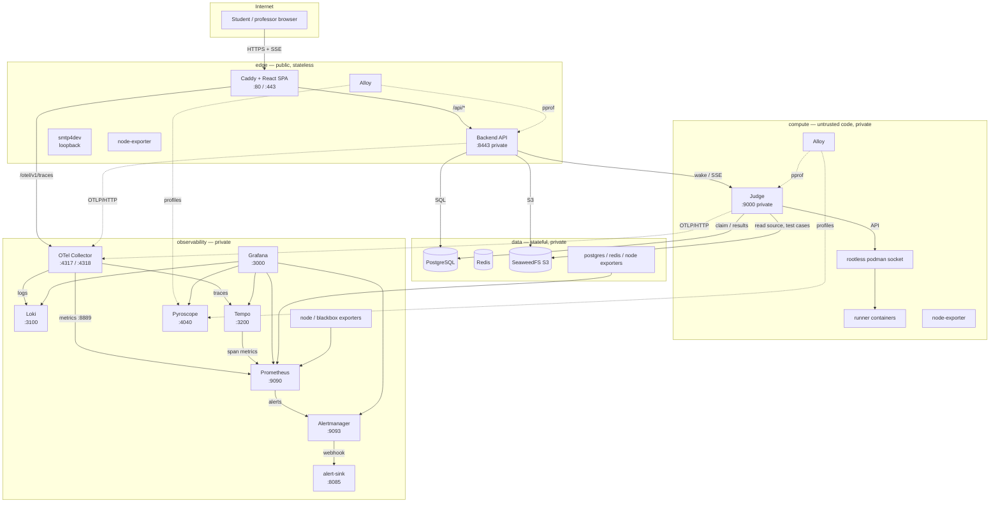

# Deployment architecture

This document explains how the RunCodes stack is distributed over the four
machines and why. The executable source of truth is
[`inventories/hosts.yml.example`](../inventories/hosts.yml.example),
[`inventories/group_vars/all/config.yml.example`](../inventories/group_vars/all/config.yml.example)
and the per-role `files/compose.yml`. Deployment values live in the untracked
`config.yml`; the tracked `main.yml` only maps them.

## Topology

## Component placement

| Machine | Components | Why here |
| --- | --- | --- |
| `edge` | Caddy + SPA, backend API, smtp4dev, node-exporter, Alloy | The only public entry point. The SPA and API are same-origin, so Caddy can proxy `/api/*` without CORS or a build-time API URL. The backend is stateless and can be rebuilt. The mail catcher is a local convenience and only publishes loopback ports. |
| `data` | PostgreSQL, Redis, SeaweedFS, postgres-exporter, redis-exporter, node-exporter | All durable state in one backup boundary. These services are private and disk/memory-bound, not request-bound. Co-locating Redis with the database keeps cache traffic and Postgres traffic on one private-network hop and frees the edge to be stateless. |
| `compute` | Judge, rootless podman, runner containers, node-exporter, Alloy | Untrusted submissions need a separate failure and trust domain. The judge gets the podman socket, the execution directory and network access only to PostgreSQL and SeaweedFS. It has no public ports and no container-runtime socket other than its rootless Podman socket. |
| `observability` | OTel Collector, Prometheus, Alertmanager, alert-sink, Loki, Tempo, Pyroscope, Grafana, node-exporter, blackbox-exporter | Telemetry storage has a different resource profile (disk, compaction, query spikes) and upgrade cadence. A dedicated host avoids competing with API latency, and gives operators one private endpoint for all signals. |

### Why these placements

- **The edge is the only public host.** Only 80/443 are bound to the public
  interface. Everything else binds to `private_ip`; the deployment never relies
  on UFW alone, because the container engine publishes ports through its own netavark/iptables chains.
- **The backend sits with Caddy.** It preserves the existing same-origin design
  (`/api/*` and the SSE stream through Caddy), avoids CORS, and keeps the
  latency-sensitive hop local. The backend is stateless; PostgreSQL, Redis and
  S3 are remote.
- **Redis lives on the data host, not the edge.** Redis is stateful (sessions,
  rate limiting, cache). Keeping all state on `data` makes the edge a pure
  compute/entry tier.
- **PostgreSQL and SeaweedFS share a host.** Both are stateful and both are
  backed up, but they have different access patterns. With only four machines,
  grouping them avoids dedicating a whole machine to object storage while
  keeping them off the public edge and off the untrusted-code host. If disk I/O
  becomes the bottleneck, split SeaweedFS onto
  its own node first.
- **The judge is not on the data host.** Submissions can be CPU-, memory- and
  process-heavy, and the judge needs a rootless podman socket plus a shared
  execution directory. Isolating it protects the database and object store from
  noisy or malicious runs.
- **Observability is not on the edge.** Loki/Tempo/Prometheus compactions and
  query spikes are bursty; keeping them off the request path avoids correlated
  latency. It also makes the observability host the single place to secure and
  back up telemetry.
- **One central collector, one Alloy per profiling host.** The collector is a
  single OTLP gateway with one place to configure batching, retries and memory
  limits. Profiles are different: pprof listeners are internal to each app's
  compose network and are deliberately not published. Alloy therefore runs on
  the edge and compute hosts, scrapes `backend:6060` / `judge:6060` locally, and
  pushes profiles to Pyroscope over the private network.
- **Prometheus scrapes across the private network.** Host/metrics exporters and
  Alloy expose their metrics on `private_ip`; Prometheus is the only scraper.
  This keeps the pull model and service discovery explicit and easy to audit.

### Alternatives considered

| Alternative | Why not |
| --- | --- |
| All services on one host | Simplest, but the judge, stateful data and telemetry all compete for CPU/disk, and a single compromise or disk-full event takes down everything. It also loses the public/private and trusted/untrusted separation. |
| Observability on the edge | Puts telemetry storage and its disk/CPU bursts on the request path and exposes the dashboards' host to the internet-facing tier. |
| Judge on the data host | Couples untrusted code execution to the database and object store, the two things a runaway submission must never affect. |
| Public OTLP collector | An unauthenticated public OTLP endpoint can be abused to fill Tempo/Loki/Prometheus. The edge exposes only `/otel/v1/traces` and proxies it to the private collector. |
| A collector on every host | More moving parts and no single place to reason about sampling, retry and queues. Alloy is per-host only because pprof cannot leave its compose network. |

## Network and ports

The example inventory uses four RFC 5737 documentation addresses. Replace them
with your hosts and limit the non-public ports to the four peers at the provider
firewall (or UFW). The `private_ip` of each host is the bind address for every
published non-public port:

| Group | Address | Role |
| --- | --- | --- |
| edge | `203.0.113.10` | public SPA/API edge |
| data | `203.0.113.11` | PostgreSQL, Redis, SeaweedFS |
| compute | `203.0.113.12` | judge and runner host |
| observability | `203.0.113.13` | telemetry storage and query |

### Public

| Host | Port | Service |
| --- | --- | --- |
| edge | 22/tcp | SSH (restrict to operator/VPN ranges) |
| edge | 80/tcp | Caddy: ACME HTTP challenge and redirect |
| edge | 443/tcp | Caddy: SPA, `/api/*`, `/otel/v1/traces` |

### Private (bound to `private_ip`)

| Host | Port | Service | Consumer |
| --- | --- | --- | --- |
| edge | 8443 | backend API health/ready | blackbox exporter, operator |
| edge | 9100 | node-exporter | Prometheus |
| edge | 12345 | Alloy UI/metrics | Prometheus |
| data | 5432 | PostgreSQL | backend, judge, postgres-exporter |
| data | 6379 | Redis (password required) | backend |
| data | 8333 | SeaweedFS S3 | backend, judge |
| data | 9100 | node-exporter | Prometheus |
| data | 9187 | postgres-exporter | Prometheus |
| data | 9121 | redis-exporter | Prometheus |
| compute | 9000 | judge API | backend, blackbox exporter |
| compute | 9100 | node-exporter | Prometheus |
| compute | 12345 | Alloy UI/metrics | Prometheus |
| observability | 4317 | OTLP/gRPC | future/internal exporters |
| observability | 4318 | OTLP/HTTP | backend, judge, browser via edge proxy, smoke test |
| observability | 13133 | collector health | verify/blackbox |
| observability | 8888 | collector self-metrics | Prometheus |
| observability | 8889 | application metrics (collector) | Prometheus |
| observability | 9090 | Prometheus | Grafana, verify, operator |
| observability | 9093 | Alertmanager | Prometheus, Grafana, operator |
| observability | 8085 | alert-sink | smoke test |
| observability | 3100 | Loki | collector, Grafana, verify |
| observability | 3200 | Tempo | collector, Grafana, verify |
| observability | 4040 | Pyroscope | Alloy, Grafana, verify |
| observability | 3000 | Grafana | operator (SSH tunnel) |
| observability | 9100 | node-exporter | Prometheus |
| observability | 9115 | blackbox-exporter | Prometheus |

### Host-local only

| Host | Port | Service |
| --- | --- | --- |
| edge | 8081 | smtp4dev web UI (loopback) |
| edge | 1025 | smtp4dev SMTP (loopback; backend uses the compose network) |
| compute | `/run/user/<uid>/podman` | rootless Podman runtime directory (mounted into the judge) |
| all | `backend:6060`, `judge:6060` | pprof, inside each compose network only |
| all | compose service ports | PostgreSQL/Redis/S3/collector/Tempo/Loki on their local Podman networks |

### Firewall model

1. **Bind address is the primary control.** Private services listen on
   `private_ip`, not `0.0.0.0`. Podman's published ports bypass UFW, so relying
   on host firewall rules alone would be misleading.
2. **Cloud security group / provider firewall** allows only 22 (admin ranges),
   80 and 443 (edge) from the internet, and all traffic among the four node
   addresses.
3. **UFW is optional** (`runcodes_firewall_enabled`). It is a second layer for
   SSH and host services, not the boundary for container ports. Enabling it
   requires `runcodes_firewall_ssh_cidrs` and the peer list
   (`runcodes_firewall_private_sources`) so a default-deny policy cannot lock
   the operator out.

## Data flows

### Submission path

1. Browser uploads to Caddy `/api/*`; Caddy streams the request to the backend
   over the edge compose network.
2. The backend checks the judge's `/readyz`, uploads the source to SeaweedFS
   over the private network, and inserts a `queued` commit in PostgreSQL.
3. The backend wakes the judge at `http://<compute>:9000/v1/runs/{id}` with the
   shared bearer token.
4. The judge claims the commit from PostgreSQL, downloads the source and test
   cases from SeaweedFS, and runs the language image through rootless podman.
5. Per-case results and the final state are posted back to the backend, which
   persists them and relays them to the browser over SSE.
6. The entire request chain is traced: browser fetch span → Caddy → backend →
   judge → S3/Postgres; the judge adds per-case spans and queue metrics.

### Telemetry path

| Signal | Producer | Path | Store |
| --- | --- | --- | --- |
| Traces | backend, judge | OTLP/HTTP to `<obs>:4318` → collector → OTLP/gRPC | Tempo |
| Traces | browser SPA | `https://<domain>/otel/v1/traces` → Caddy → `<obs>:4318` | Tempo |
| Metrics | backend, judge | OTLP/HTTP → collector Prometheus exporter `:8889` → scrape | Prometheus |
| Metrics | node/postgres/redis/blackbox exporters | Prometheus scrape over private network | Prometheus |
| Metrics | Tempo metrics-generator | remote write to Prometheus | Prometheus |
| Logs | backend, judge | OTLP/HTTP → collector → Loki OTLP endpoint | Loki |
| Profiles | backend/judge pprof | Alloy scrape locally → write to `<obs>:4040` | Pyroscope |
| Alerts | Prometheus rules | Alertmanager `:9093` → webhook or alert-sink | Alertmanager / receiver |

The collector is the only OTLP ingress. Tempo, Loki and Prometheus have no
public ports, and OTLP is plaintext on the private network (see the security
section).

## Persistence and backup boundary

| Data | Location | Backup |
| --- | --- | --- |
| PostgreSQL cluster | `data` Podman volume `db-data` | `pg_dump` (see deployment guide) |
| Redis AOF | `data` Podman volume `redis-data` | Optional; sessions/cache can be lost |
| SeaweedFS objects | `data` Podman volume `seaweed-data` | Volume snapshot/archive; this holds submissions and test cases |
| Telemetry | `observability` volumes | Optional; retention limits cap growth |
| Caddy certs and mail | `edge` volumes | Regenerated / disposable |
| Judge workspaces | `/opt/runcodes/exec` on `compute` | Disposable by design |

The database and object store are the only data that cannot be reconstructed.
They are intentionally on the same host to make a consistent backup window and a
single restore target. Their volumes are named Podman volumes because the
images initialize ownership and permissions; a bind mount with the wrong UID
would break PostgreSQL.

## Runtime and boot order

Every stack and every graded runner container runs as the deployment user under
**rootless Podman**:

- Each host runs its stack with `podman-compose` through a **user** systemd
  unit: `runcodes-edge`, `runcodes-data`, `runcodes-compute` or
  `runcodes-observability`. The units are enabled under `default.target` and
  started at boot through `loginctl enable-linger`.
- `net.ipv4.ip_unprivileged_port_start=80` lets the edge publish 80/443 through
  rootlessport. Port 22 and other privileged ports remain restricted.
- The compute host enables the deployment user's `podman.socket`. The judge
  container and the runner containers both use it; the judge uses
  `userns_mode: keep-id` so `/exec` and the socket have the user's ownership.
- The judge mounts the whole `/run/user/<uid>/podman` directory, so a socket
  restart is visible without recreating the judge. The compute unit
  `Requires`/`After=podman.socket`, waits for the socket, then starts the stack.
- Each unit runs `podman-compose up -d --force-recreate`; `ExecStop` runs
  `podman-compose stop`. Because `podman-compose` does not diff container
  configuration the way Docker Compose does, the units force-recreate on every
  deployment. This is a maintenance-window operation.

The judge's `/readyz` is the authoritative check: it verifies both PostgreSQL
and podman. The deployment does not declare success until it returns 200.

## Capacity and scheduling

The exact size depends on submissions and telemetry volume. Starting points:

| Host | vCPU | RAM | Disk | Notes |
| --- | --- | --- | --- | --- |
| edge | 2 | 4 GB | 40 GB | Caddy + Go backend + smtp4dev; pulls published images on deploy |
| data | 4 | 8 GB | 100–200 GB SSD | PostgreSQL + SeaweedFS grow with submissions; Redis is small |
| compute | 4 | 8–16 GB | 80–150 GB SSD | Runner images are numerous; `JUDGE_CONCURRENCY × 1.5 GiB` is the execution RAM floor |
| observability | 4 | 8–16 GB | 200–400 GB SSD | Prometheus 15d/8 GB cap, Loki/Tempo/Pyroscope 7d each, plus compaction headroom |

The judge's memory is not the container's `mem_limit`: each runner container is
capped by `JUDGE_CONTAINER_MEMORY_BYTES` (1.5 GiB by default) and
`JUDGE_CONCURRENCY` (4 by default) workers can run at once. Size the compute
host for at least 6 GiB of runner memory plus the host, Podman and judge.

Telemetry storage is capped by retention, not by a hard quota on the filesystem:

- Prometheus: `runcodes_prometheus_retention_time` (15d) and
  `runcodes_prometheus_retention_size` (8 GB).
- Loki: 168h in `observability/loki/loki.yaml`.
- Tempo: `runcodes_tempo_retention_hours` (168h).
- Pyroscope: 168h in `observability/pyroscope/config.yaml`.

Always leave free disk for compactions. The `RunCodesHostDiskSpaceLow` alert
fires below 15% free on any host; it is a last resort, not a capacity plan.

## Scaling beyond four hosts

This topology is deliberately fixed at four machines. When it outgrows them,
split in this order:

1. **Compute**: add more `compute` hosts and point backend/judge at a load
   balancer; the judge claims from PostgreSQL safely across instances. Keep
   each host's `/opt/runcodes/exec` local and its own podman socket.
2. **Observability storage**: move Prometheus to remote write (Mimir/Thanos),
   Loki/Tempo/Pyroscope to object storage, and make the collector replicas.
   Grafana can move to an external database and SSO.
3. **Data**: split SeaweedFS from PostgreSQL, then use managed PostgreSQL and
   object storage with backups and PITR.
4. **Edge**: run multiple stateless edge hosts behind a load balancer; the
   backend is stateless and the SSE stream is sticky only for the duration of a
   connection (reconnect replays persisted state).
