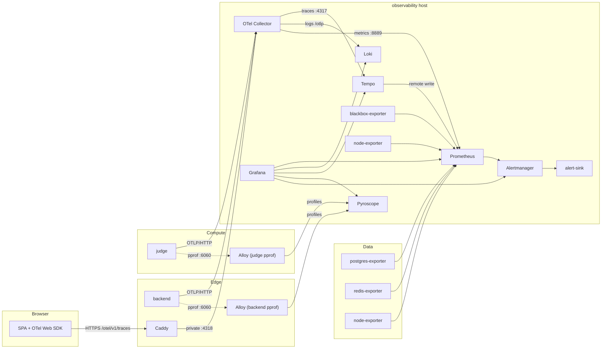

# Observability in the four-machine deployment

The deployment ships the full instrumentation that the application already
emits: **traces, metrics, logs, continuous profiles and alerts**, collected from
the edge, compute and data hosts and stored on the observability host.

This document covers what is deployed, how the signals cross host boundaries,
how to access and validate them, and how to operate them. The upstream
architecture and local-development details are in
[`docs/observability/README.md`](../../../docs/observability/README.md) and
[`docs/observability/runbook.md`](../../../docs/observability/runbook.md); this
document only describes the four-machine variant.

- [Signal inventory](#signal-inventory)
- [Where everything runs](#where-everything-runs)
- [Cross-host data flow](#cross-host-data-flow)
- [Application instrumentation](#application-instrumentation)
- [Browser tracing and the public OTLP path](#browser-tracing-and-the-public-otlp-path)
- [Metrics: scrape jobs and exporters](#metrics-scrape-jobs-and-exporters)
- [Logs, traces and profiles](#logs-traces-and-profiles)
- [Alerting](#alerting)
- [Access and dashboards](#access-and-dashboards)
- [Validation](#validation)
- [Runbook](#runbook)
- [Adding a service or signal](#adding-a-service-or-signal)
- [Retention and capacity](#retention-and-capacity)
- [Security](#security)
- [Known limitations](#known-limitations)

## Signal inventory

| Signal | Source | Collection | Storage | Query |
| --- | --- | --- | --- | --- |
| Traces | backend, judge, browser SPA | OTel Collector | Tempo | Grafana Explore / Tempo API |
| Application metrics | backend, judge | OTel Collector Prometheus exporter | Prometheus | Grafana / PromQL |
| Host metrics | all four hosts | node-exporter | Prometheus | Grafana / PromQL |
| Database metrics | PostgreSQL | postgres-exporter | Prometheus | Grafana / PromQL |
| Cache metrics | Redis | redis-exporter | Prometheus | Grafana / PromQL |
| Synthetic availability | frontend, backend, judge, observability services | blackbox-exporter | Prometheus | Grafana / PromQL |
| Application logs | backend, judge | OTel logs → collector → Loki OTLP | Loki | Grafana Explore / LogQL |
| CPU profiles | backend, judge pprof | Alloy → Pyroscope | Pyroscope | Grafana profiles / span profiles |
| Alerts | Prometheus rules + Grafana-managed rule | Alertmanager | Alertmanager / receiver / alert-sink | Alertmanager UI, receiver, `:8085/alerts` |
| Dashboards | provisioned JSON | Grafana provisioning | Grafana SQLite volume | Grafana |

The in-container `monitor/` process is not a separate service. It is compiled
into the runner images and reports per-case limits, CPU time and memory from
inside the graded container; the judge turns those into per-case spans and
metrics.

## Where everything runs

| Host | Observability components | Exposed on |
| --- | --- | --- |
| edge | node-exporter, Alloy (backend pprof) | `private_ip:9100`, `private_ip:12345` |
| data | node-exporter, postgres-exporter, redis-exporter | `private_ip:9100`, `:9187`, `:9121` |
| compute | node-exporter, Alloy (judge pprof) | `private_ip:9100`, `private_ip:12345` |
| observability | OTel Collector, Prometheus, Alertmanager, alert-sink, Loki, Tempo, Pyroscope, Grafana, node-exporter, blackbox-exporter | private ports listed below |

Collector and storage ports on the observability host:

| Port | Service | Notes |
| --- | --- | --- |
| 4317 | OTLP/gRPC | private; available for future services |
| 4318 | OTLP/HTTP | private; backend, judge, edge proxy, smoke test |
| 13133 | collector health | `/health/status` |
| 8888 | collector self-metrics | Prometheus scrape |
| 8889 | application metrics | Prometheus scrape |
| 9090 | Prometheus | UI/API, remote-write receiver |
| 9093 | Alertmanager | UI/API |
| 8085 | alert-sink | test receiver |
| 3100 | Loki | API; `/ready` |
| 3200 | Tempo | API; `/ready` |
| 4040 | Pyroscope | API/UI; `/ready` |
| 3000 | Grafana | UI; private, use an SSH tunnel |
| 9100 | node-exporter | Prometheus scrape |
| 9115 | blackbox-exporter | Prometheus probe endpoint |

Every port binds to `private_ip`. The only telemetry traffic that crosses the
public interface is the edge Caddy route `POST /otel/v1/traces`.

## Cross-host data flow



The collector is the single OTLP ingress. Nothing else on the observability
host accepts application telemetry. Prometheus is the single scraper. Alloy is
the only component that pulls pprof, and it runs on the host whose compose
network contains the pprof listener.

## Application instrumentation

The backend and judge are instrumented with the OpenTelemetry Go SDK. The
deployment sets the same variables on both, in their compose files:

| Variable | Value in this deployment | Meaning |
| --- | --- | --- |
| `OTEL_EXPORTER_OTLP_ENDPOINT` | `http://<observability private_ip>:4318` | Enables export; unset means instrumentation is a no-op. |
| `OTEL_EXPORTER_OTLP_PROTOCOL` | `http/protobuf` | OTLP/HTTP. |
| `OTEL_SERVICE_NAME` | `runcodes-backend` / `runcodes-judge` | `service.name`. |
| `OTEL_SERVICE_VERSION` | `runcodes_version` | `service.version`, e.g. a release id. |
| `DEPLOYMENT_ENVIRONMENT` | `runcodes_environment` | `deployment.environment.name`. |
| `OTEL_TRACES_SAMPLER` | `runcodes_otel_traces_sampler` | `parentbased_always_on` by default (deterministic smoke test). |
| `OTEL_TRACES_SAMPLER_ARG` | `runcodes_otel_traces_sampler_arg` | 1.0 by default. |
| `OTEL_METRIC_EXPORT_INTERVAL` | 10000 ms | Metrics export cadence. |
| `OTEL_BSP_SCHEDULE_DELAY` / `OTEL_BLRP_SCHEDULE_DELAY` | 2000 ms | Span/log batch delays. |
| `PPROF_ADDR` | `:6060` | Internal pprof listener for Alloy. Not published. |
| `OTEL_SDK_DISABLED` | `false` | Standard kill switch. |

The backend also returns a `TraceId` response header (32 hex chars) and
`X-Trace-Sampled`, which the smoke test uses to follow one exact trace.

To reduce trace volume in production, set
`runcodes_otel_traces_sampler: parentbased_traceidratio` and
`runcodes_otel_traces_sampler_arg: "0.1"`. The smoke test may then miss its
exact trace; run it with the always-on sampler or accept retries. Metrics and
logs are sampled independently of the trace sampler.

## Browser tracing and the public OTLP path

The SPA is built with:

```
VITE_OTEL_ENABLED=true
VITE_OTEL_EXPORTER_OTLP_ENDPOINT=/otel
VITE_OTEL_SERVICE_NAME=runcodes-frontend
VITE_OTEL_SERVICE_VERSION=<runcodes_version>
VITE_DEPLOYMENT_ENVIRONMENT=<runcodes_environment>
VITE_OTEL_TRACES_SAMPLER_ARG=<runcodes_otel_traces_sampler_arg>
```

The exporter appends `/v1/traces`, so it posts to
`https://<domain>/otel/v1/traces` on the same origin as the SPA. Caddy matches
that exact path, strips `/otel`, and proxies to the private collector `:4318`:

```
handle /otel/v1/traces {
    uri strip_prefix /otel
    reverse_proxy <observability private_ip>:4318
}
```

Because the request is same-origin, there is no CORS preflight in the normal
path. The collector still allows the public origin, the edge private origin and
the local Vite origins for operators running the upstream smoke test directly
against `:4318`.

Only the traces path is proxied, and Caddy caps its request body at 4 MiB.
Metrics and logs from browsers would be a much larger and unauthenticated
ingestion surface, so they are not exposed on the edge. The browser SDK only
exports traces.

The backend continues the browser's `traceparent`, so a click that triggers a
fetch becomes one trace spanning the browser, Caddy, backend, judge, S3 and
PostgreSQL. A browser trace appears in Tempo with `service.name=runcodes-frontend`.

## Metrics: scrape jobs and exporters

Prometheus runs on the observability host and scrapes:

| Job | Targets | Source |
| --- | --- | --- |
| `prometheus` | `localhost:9090` | self |
| `otel-collector` | `otel-collector:8889` | application metrics from backend/judge |
| `otel-collector-internal` | `otel-collector:8888` | collector queue/drop/export metrics |
| `alertmanager` | `alertmanager:9093` | alerting |
| `loki` | `loki:3100` | log storage |
| `tempo` | `tempo:3200` | trace storage |
| `grafana` | `grafana:3000` | dashboards |
| `pyroscope` | `pyroscope:4040` | profiles |
| `node-exporter` | all four hosts `:9100` | CPU, memory, disk, network, filesystem |
| `postgres-exporter` | data `:9187` | `pg_up`, connections, database stats |
| `redis-exporter` | data `:9121` | `redis_up`, memory, clients |
| `alloy` | edge/compute `:12345` | profiler health and write metrics |
| `blackbox-http` | public frontend, backend/judge health, Grafana/Loki/Tempo/Alertmanager/Prometheus/Pyroscope | synthetic availability |

The collector's Prometheus exporter adds `service_name` and the other
low-cardinality OTel resource attributes as labels, so application metrics can
be grouped by service without joining `target_info`. The judge also exports
`runcodes_judge_queue_depth` and `runcodes_judge_queue_oldest_age_seconds` from
its PostgreSQL queue. Tempo's metrics-generator remote-writes span metrics and
service graphs to Prometheus, which power the trace panels and graph.

The repository's alert rules live in
[`observability/prometheus/rules/runcodes-alerts.yml`](../../../observability/prometheus/rules/runcodes-alerts.yml)
and are copied to `/opt/runcodes/config/observability/rules/` on the
observability host. Prometheus is restarted by an Ansible handler when the
rules or scrape config change.

## Logs, traces and profiles

### Logs

The backend and judge write structured logs to stdout **and** forward them as
OTLP log records to the collector. The collector sends them to Loki's OTLP
endpoint. OTel attaches `trace_id`/`span_id`, which Loki stores as structured
metadata; Grafana's Loki datasource derives a "View trace in Tempo" link from
`trace_id`.

Only application logs are shipped. PostgreSQL, Redis, SeaweedFS, Caddy and the
observability containers log to the Podman journal (or the configured log
driver); use `podman-compose ... logs` or `journalctl --user` on the host. Adding log
discovery to Alloy is a future extension.

### Traces

The collector exports traces to Tempo over OTLP/gRPC. Trace data includes:

- inbound HTTP spans (`otelchi`) and outbound HTTP spans (`otelhttp`);
- database spans (`otelsql`) for claims, queries and updates;
- per-commit `judge.process_commit` and per-case `judge.grade_test_case` spans;
- S3 downloads/uploads;
- browser fetch spans, continued by the backend.

Tempo's metrics-generator produces span metrics (latency, errors, calls) and a
service graph, which are remote-written to Prometheus. Grafana's Tempo
datasource has trace-to-logs, trace-to-metrics and trace-to-profiles links
provisioned.

### Profiles

Alloy on the edge scrapes `backend:6060`; Alloy on compute scrapes
`judge:6060`. Both write to Pyroscope on the observability host. The pprof
listeners are never published. The `otel-profiling-go` bridge adds
`trace_id`/`span_id` labels to profiles and `pyroscope.profile.id` to spans, so
a span in Grafana can open its matching flame graph. Short spans may have no CPU
samples; the profile panel can be empty for sub-20 ms work.

## Alerting

Prometheus evaluates the rules and sends firing alerts to Alertmanager. The
default route delivers to the URL in
`/opt/runcodes/secrets/alertmanager_webhook_url`:

- if `vault_alertmanager_webhook_url` is set, that is the real receiver;
- if it is empty, Ansible writes the alert-sink URL, so alerts are still
  delivered locally for validation.

The `ObservabilitySmokeTest` alert is always routed to the `alert-sink`
receiver. This lets `verify.yml` prove the complete rule → Alertmanager →
webhook path without touching the production receiver. Critical alerts get a
shorter group wait; warning and critical alerts for the same service/name are
inhibited by the critical one.

The alert rules cover:

- observability target down (any Prometheus scrape job);
- failing blackbox probes;
- backend/judge 5xx rate and p95 latency;
- trace error ratio from Tempo span metrics;
- judge queue depth and stalled queue;
- no profiles arriving;
- PostgreSQL down and connections high;
- Redis down;
- host root filesystem below 15% free;
- collector export failures.

Grafana also provisions one example Grafana-managed alert rule and an
Alertmanager contact point so the unified alerting path is exercised. The
Prometheus rules are the source of truth.

## Access and dashboards

Grafana, Prometheus, Alertmanager, Loki, Tempo and Pyroscope are **private**.
Use an SSH tunnel through the edge:

```bash
ssh -L 3000:203.0.113.13:3000 \
    -L 9090:203.0.113.13:9090 \
    -L 9093:203.0.113.13:9093 \
    -L 4040:203.0.113.13:4040 \
    runcodes@<edge-public-address>
```

Then:

| URL | Purpose |
| --- | --- |
| <http://localhost:3000> | Grafana; home dashboard `runcodes-overview` |
| <http://localhost:9090> | Prometheus targets, queries, rules |
| <http://localhost:9093> | Alertmanager silences/status |
| <http://localhost:4040> | Pyroscope profiles UI |

The Grafana admin user is `runcodes_grafana_admin_user` (default `admin`); the
password is `vault_grafana_admin_password`. The dashboard includes service
request rate/errors/latency, logs, span metrics, host/database resource panels
and links to Explore. The `service` template variable filters by OTel
`service.name`.

Do not expose these ports through the edge Caddy. They have no authentication
(except Grafana's login) and contain request metadata, SQL statements (without
parameters), user ids and email addresses.

## Validation

### Automated

```bash
cd deploy/ansible
ansible-playbook playbooks/verify.yml --ask-vault-pass
```

`verify.yml` waits for every service, asserts every active Prometheus target is
`up`, asserts every blackbox probe is 1, checks backend metrics and the judge
queue gauge, and (by default) runs the upstream
[`scripts/observability/smoke-test.sh`](../../../scripts/observability/smoke-test.sh)
from the observability host. The smoke test:

1. generates backend/judge/frontend traffic and captures the exact `TraceId`;
2. finds backend and judge metrics in Prometheus;
3. finds backend/judge logs in Loki, including the trace-correlated line;
4. finds the exact trace in Tempo;
5. checks the collector's browser-origin CORS path and ingests a browser trace;
6. checks Grafana's Prometheus/Loki/Tempo/Pyroscope datasources, the dashboard,
   provisioned alert rules and the Alertmanager proxy;
7. checks Pyroscope profiles and the Alloy/Pyroscope targets;
8. injects an `ObservabilitySmokeTest` alert and verifies it reached the
   alert-sink.

To also exercise the real judge path (admin login, disposable exercise,
submission, per-case span and span-to-profile attribute):

```bash
ansible-playbook playbooks/verify.yml --ask-vault-pass \
  -e runcodes_run_submission_smoke_test=true
```

To skip the slower smoke test:

```bash
ansible-playbook playbooks/verify.yml --ask-vault-pass -e runcodes_run_smoke_test=false
```

### Manual checks (through the tunnel)

```bash
# Prometheus targets
curl -s http://localhost:9090/api/v1/targets \
  | jq -r '.data.activeTargets[] | "\(.labels.job)\t\(.health)\t\(.lastError // "")"'

# Application metrics
curl -sG http://localhost:9090/api/v1/query \
  --data-urlencode 'query=sum(http_server_request_duration_seconds_count{service_name="runcodes-backend"})' \
  | jq '.data.result[0].value'

# Judge queue
curl -sG http://localhost:9090/api/v1/query \
  --data-urlencode 'query=runcodes_judge_queue_depth' | jq -c '.data.result'

# Loki labels and a log line
curl -sG http://localhost:3100/loki/api/v1/labels | jq '.data'
curl -sG http://localhost:3100/loki/api/v1/query_range \
  --data-urlencode 'query={service_name="runcodes-backend"} |= "error"' \
  --data-urlencode "start=$(( $(date +%s) - 900 ))" \
  --data-urlencode "end=$(date +%s)" --data-urlencode 'limit=20' | jq '.data.result | length'

# Tempo trace by id
curl -s -o /dev/null -w '%{http_code}\n' http://localhost:3200/api/traces/<32-hex-trace-id>

# Pyroscope and Alloy
curl -s http://localhost:4040/ready
curl -s http://<edge-private>:12345/-/ready

# Grafana datasource health
PASSWORD=$(cat /opt/runcodes/secrets/grafana_admin_password)  # on obs host
for ds in prometheus loki tempo pyroscope; do
  curl -s -u "admin:$PASSWORD" "http://localhost:3000/api/datasources/uid/$ds/health" | jq -c .
done
```

A complete trace id comes from the backend response header:

```bash
curl -sD - -o /dev/null http://<edge-private>:8443/api/v1/settings/public | grep -i traceid
```

## Runbook

### No application metrics in Prometheus

1. `curl http://<obs>:13133/health/status` and
   `curl http://<obs>:8889/metrics | head` (may be empty until a batch).
2. Check the `otel-collector` target in Prometheus.
3. On edge/compute, `podman-compose -p runcodes-edge -f compose.yml logs backend | grep -i opentelemetry`
   (or the compute project for the judge);
   the startup line says enabled/disabled.
4. Check the app can reach `<obs>:4318` (provider firewall/private network).
5. Check collector logs for export errors and
   `otelcol_exporter_send_failed_metric_points_total`.
6. Query the actual label with
   `{service_name="runcodes-backend"}`; inspect `/api/v1/label/__name__/values`.

### No logs in Loki

1. Are the apps logging to stdout? `podman-compose -p runcodes-edge -f compose.yml logs backend`.
2. Collector accepted logs:
   `otelcol_receiver_accepted_log_records_total` on `:8888`.
3. Loki ready? `curl <obs>:3100/ready`.
4. Query `{service_name="runcodes-backend"}` without a filter; then try the
   `trace_id` structured-metadata filter.
5. Check the collector's Loki exporter and Loki compactor/disk space.

### No traces in Tempo

1. Backend returns a `TraceId` header? If not, OTel is disabled or the request
   is not instrumented.
2. `OTEL_TRACES_SAMPLER` is not `always_off`; ratio samplers can miss a trace.
3. Collector ↔ Tempo: `tempo:4317`, collector logs, `otelcol_exporter_*`.
4. Tempo ready and disk not full; retention may have dropped old traces.
5. Use the exact trace id, not a service search, to distinguish sampling from
   ingestion.

### No profiles in Pyroscope

1. `curl <edge>:12345/-/ready` and `<compute>:12345/-/ready`.
2. Alloy logs show scrape errors? `podman-compose -p runcodes-edge -f compose.yml logs alloy` (or compute).
3. `PPROF_ADDR=:6060` is set on the app; Alloy can reach `backend:6060` /
   `judge:6060` on the same compose network.
4. Pyroscope ready at `<obs>:4040/ready`; check its disk and retention.
5. `pyroscope_distributor_profiles_received_total` in Prometheus.

### Prometheus target down

Use the Prometheus UI; `lastError` names the cause. For exporters on data,
check the password rotation order. For node-exporter/alloy, check the private
port and the container. For blackbox, check the probe target itself with
`curl`.

### Alertmanager does not deliver

- Check `alertmanager.yml` route and the receiver file.
- If the URL is empty, everything goes to the sink (by design).
- The test alert always goes to the sink; check `:8085/alerts`.
- Check Alertmanager logs for TLS/HTTP errors; the receiver must accept
  Alertmanager's JSON webhook payload.
- Test with the manual `curl` in
  [`DEPLOYMENT.md`](DEPLOYMENT.md#alerts-do-not-arrive-at-the-receiver).

### Grafana datasource unhealthy

- Prometheus/Loki/Tempo/Pyroscope are on the same compose network; service
  names are `prometheus`, `loki`, `tempo`, `pyroscope`.
- Check each service's readiness and `/api/health`/`/ready`.
- Grafana's generic health endpoint intentionally reports
  `plugin.unavailable` for an external Alertmanager datasource; use the
  `/api/alertmanager/alertmanager/api/v2/status` proxy instead. The smoke test
  does this.

### Collector dropped telemetry

Check `otelcol_exporter_queue_size`, `otelcol_exporter_send_failed_*`,
`otelcol_processor_dropped_*` and the collector's memory limiter. Increase the
collector memory limit or reduce sampling. A restarted Tempo/Loki is normal
during a deploy; the collector retries with a queue.

### Disk pressure

Prometheus/Loki/Tempo/Pyroscope retention caps bound their growth, but
compactions need free space. The `RunCodesHostDiskSpaceLow` alert fires below
15%. Lower retention, free space, or move the stores to object storage. Do not
delete volumes without knowing which signal they hold.

## Adding a service or signal

This deployment is fixed at four machines, but a new service or exporter can be
added to an existing host:

1. **Application telemetry**: set the same `OTEL_EXPORTER_OTLP_ENDPOINT` and
   `OTEL_SERVICE_NAME` on the new service; the collector accepts OTLP on the
   private network. If it is a Go service with pprof, set `PPROF_ADDR=:6060`,
   add it to the edge/compute Alloy target list, and restart Alloy.
2. **Host metrics**: if the service runs on a new host, run node-exporter there
   and add the target to `node-exporter` in
   [`roles/rc-observability/templates/prometheus.yml.j2`](../roles/rc-observability/templates/prometheus.yml.j2).
3. **Metrics exporter**: add a scrape job (with a `node` label) and a
   blackbox probe if it has a health endpoint; restart Prometheus via the
   handler or manually.
4. **Alerts**: add rules to the repository's
   `observability/prometheus/rules/runcodes-alerts.yml`; the observability role
   copies and reloads them. Validate with `promtool check rules`.
5. **Dashboard**: provision it from
   `observability/grafana/dashboards/`; do not create it only in the UI.
   Grafana restarts via the handler when the dashboard tree changes.
6. **Logs**: emit OTel logs (or plain stdout plus a future Alloy filelog
   pipeline). The current Loki pipeline is application OTLP only.

## Retention and capacity

| Store | Default retention | Guardrail |
| --- | --- | --- |
| Prometheus | 15 days | `runcodes_prometheus_retention_size` 8 GB (whichever first) |
| Loki | 7 days (168h) | `limits_config.retention_period` in `loki.yaml`; compactor |
| Tempo | 7 days | `runcodes_tempo_retention_hours`; 1h compacted block retention |
| Pyroscope | 7 days | `limits.retention_period` in `pyroscope.yaml` |
| Grafana | SQLite volume | Dashboards/provisioning in git |
| Alertmanager | State volume | Notification log/state |

The observability host needs free space beyond these caps for WAL and
compactions. A 200–400 GB SSD is a reasonable starting point for a small
deployment; monitor `node_filesystem_avail_bytes` and the disk alert. For real
retention, move Loki/Tempo/Pyroscope to object storage and Prometheus to remote
write (Mimir/Thanos), as described in the upstream production guidance.

## Security

- The collector, Prometheus, Alertmanager, Loki, Tempo, Pyroscope and Grafana
  have no authentication beyond Grafana's login. They are private; never expose
  them directly. Use a VPN/SSH tunnel or an authenticating reverse proxy with
  SSO.
- OTLP traffic is plaintext on the private network. If the network is not
  trusted, use WireGuard/IPsec or enable TLS/mTLS on the collector and storage
  receivers. The application endpoints are configurable via standard
  `OTEL_EXPORTER_OTLP_*` variables.
- The public browser path is unauthenticated OTLP traces only. It is rate- and
  volume-limited only by the collector memory limiter and Tempo retention. For
  a hostile public deployment, put a WAF/rate limit in front of
  `/otel/v1/traces`, use a browser-specific collector with a key, or disable
  browser telemetry.
- Profiles expose heap, goroutine, CPU and command-line data through pprof.
  They are not published; Alloy reaches them over the local compose network.
  Do not add ingress or host port mappings for `:6060`.
- Loki logs may contain user ids, email addresses, request paths and error
  details. SQL span attributes contain statements, not parameters, by default.
  Do not enable body logging in production; restrict access to Grafana and the
  Loki API.
- Grafana's anonymous access, sign-up and plugin downloads are disabled. Use
  SSO/OAuth and an external database for a team deployment. The admin password
  is a mounted file, not an image layer or a committed value.
- Alertmanager receiver credentials live in files (`*_file`), not in YAML. Keep
  the webhook URL in the vault/secret manager and rotate it.
- Secrets in `.env` are root-owned 0600. The container sees only the variables
  it needs; podman inspect can read them. For a stricter model, use Podman
  secrets or a secret manager and change the compose `environment` entries to
  `*_FILE` variants where the service supports them.

## Known limitations

These are intentional in this four-machine reference topology:

- **Single-node storage, no HA.** Prometheus/Loki/Tempo/Pyroscope run one
  replica with local volumes. If the observability host dies, telemetry is
  unavailable; the application keeps serving and OTLP exports retry/drop.
- **No object storage.** Retention is bounded by local disk. The upstream
  `pyroscope/config.s3.example.yaml` and the production guidance describe the
  object-store path.
- **Only application logs.** Infrastructure/container logs stay in the Podman
  journal and are not in Loki.
- **Coarse judge internals.** HTTP/DB/S3/per-commit/per-case spans are present;
  the container's internal compile/test loop is one `judge.run_container` span.
- **Browser tracing is build-time.** A frontend build without
  `VITE_OTEL_ENABLED=true` emits no browser spans.
- **Span profiles are sampling-dependent.** Very short spans may have no CPU
  samples even with the `otel-profiling-go` bridge.
- **Alerting is a webhook.** The bundled sink is a test fixture, not a
  paging/incident product. Configure a real receiver and on-call process.
- **Metamonitoring is limited.** Prometheus scrapes the collector and its own
  targets, but there is no separate "watch the watcher" Prometheus/Alertmanager
  pair. A down observability host is detected by users, not by this stack.
- **No audit trail of configuration changes.** Use git and Ansible diffs; the
  hosts do not enforce drift detection.
