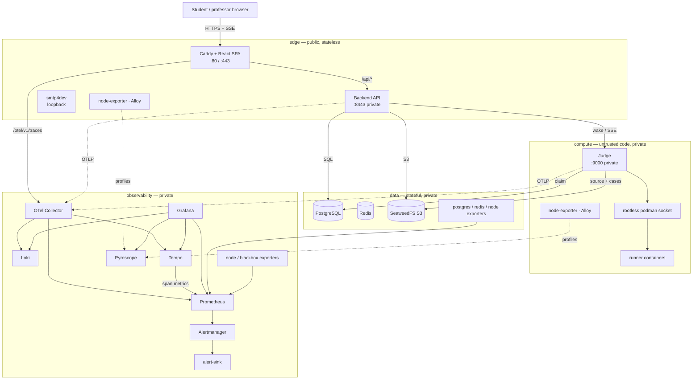

# Deployment overview

RunCodes ships three deployment paths. They run the same services; they differ
in where the images come from and how many hosts they use.

| | Source-build Compose | Image-based Compose | Four-machine Ansible |
| --- | --- | --- | --- |
| Intended use | local development, demos | a single production host | a production-shaped reference deployment |
| Hosts | 1 | 1 | 4 (`edge`, `data`, `compute`, `observability`) |
| Container runtime | Docker Compose v2 or Podman | Docker Compose v2 | rootless Podman + `podman-compose` |
| Images | built from source | pulled from GHCR | pulled from GHCR |
| Process supervision | Compose restart policy | Compose restart policy | user systemd units, linger, boot start |
| Secrets | environment / root `.env` | `deploy/compose/.env` | Ansible Vault, deployment-user-owned files |
| Telemetry | opt-in overlay (`make observability-up`) | not included; use Ansible | full stack on the observability host |
| TLS | Caddy, optional hostname | Caddy, optional hostname | Caddy + ACME on the public edge |
| Backups | manual `pg_dump` / volume archive | manual `pg_dump` / volume archive | documented backup boundary on `data` |

The [source-build Compose stack](./compose.md) is the development and demo path:
`docker compose up --build` builds the application on the host. The
[image-based Compose stack](./image-compose.md) pulls the published images and
runs `deploy/compose/deploy.sh`; it is the single-host deployment path. For
separated trust domains, use [Ansible](./ansible-setup.md).

## The four-machine topology

The deployment uses four example RFC 5737 addresses. Replace them with your
hosts and restrict every non-public port to the four peers at the provider
firewall.

## Why four hosts

- **Edge is the only public surface.** Caddy, the SPA and the API are
  same-origin, which preserves the `/api` and SSE design without CORS. The
  backend is stateless and can be rebuilt.
- **Data groups the backup boundary.** PostgreSQL, Redis and SeaweedFS are the
  stateful services. They are private and sized around disk and memory.
- **Compute isolates untrusted code.** The judge gets the rootless Podman socket
  and the execution directory, with no public ports. Runner containers cannot
  reach the edge or the telemetry store.
- **Observability has a different resource profile.** Prometheus, Loki, Tempo
  and Pyroscope are disk-heavy and have a different upgrade cadence. A dedicated
  host keeps telemetry from competing with request handling.

The placement rationale, alternatives and capacity guidance are in
[Security & scaling](./security.md#alternatives-considered).

## Images and releases

The application images are built and published by GitHub Actions, not on the
hosts:

| Image | Source | Workflow |
| --- | --- | --- |
| `ghcr.io/runcodes-icmc/runcodes-frontend` | `frontend/` | `app-images.yml` |
| `ghcr.io/runcodes-icmc/runcodes-backend` | `backend/` | `app-images.yml` |
| `ghcr.io/runcodes-icmc/runcodes-database` | `database/` | `app-images.yml` |
| `ghcr.io/runcodes-icmc/runcodes-judge` | `judge/` | `app-images.yml` |
| `ghcr.io/runcodes-icmc/runcodes-monitor` | `monitor/` | `monitor.yml` (called by `runners.yml`) |
| `ghcr.io/runcodes-icmc/runcodes-runner-<language>` | `runners/` | `runners.yml` |

The workflows run on `v*.*.*` tags and manual dispatch, publish `:latest` and
version tags, and build for `linux/amd64`. The Ansible and image-based Compose
deployments default to `:latest` and can pin any release tag. See
[CI/CD & releases](../ci-cd.md).

The workflows derive the namespace from the repository that runs them. The
table shows the upstream `runcodes-icmc/runcodes` output; a fork publishes
`ghcr.io/<owner>/<repo>-frontend`, `...-monitor`, `...-runner-<language>` and so
on. Both image-based paths let the deployment choose the registry, namespace
and runner prefix, so point them at the fork namespace when deploying fork
images. See [CI/CD & releases](../ci-cd.md).

::: warning Judge and runners are one contract
Changing `container.config` or the milestone format requires a judge release
**and** a rebuild of the base/language images. A new judge against old images
logs nonce-less milestones and times out.
:::

## What "production-shaped" means here

The four-machine deployment is production-shaped, not highly available:

- private networking and a public edge;
- published, pinned images;
- secrets in an encrypted vault;
- TLS at Caddy;
- retention limits and backups;
- health checks and a verification playbook.

It runs one replica of each service. A host failure is an outage, and telemetry
is a single point of failure for observability only. See
[Known limits](./security.md#known-limits).

## Where to start

1. **Just trying it** → [Docker Compose from source](./compose.md) or
   [Getting started](../guide/getting-started.md).
2. **A single production host** → [Image-based Compose](./image-compose.md) and
   the [production checklist](./checklist.md).
3. **Four machines** → [Ansible setup](./ansible-setup.md), then the
   [production checklist](./checklist.md).
4. **Running it after day one** → [Ansible operations](./ansible-operations.md)
   and [Platform operations](../administration/operations.md).
5. **Adding telemetry** → [Observability](../observability/index.md).
