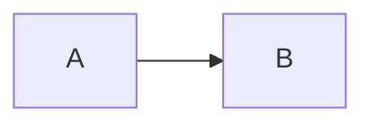

# Documentation site

This website is a static site generated with [VitePress](https://vitepress.dev/)
from Markdown in `docs-site/`. It is deployed to GitHub Pages by
`.github/workflows/docs.yml` and published at:

**<https://reisaraujo-miguel.github.io/runcodes/>**

## Why VitePress

- Markdown-first and fast, with no runtime server;
- built-in local search, dark mode, sidebar navigation and last-updated dates;
- Vue components when a page needs one;
- Mermaid diagrams via a plugin;
- a static output that GitHub Pages can serve directly.

## Structure

```text
docs-site/
├── package.json               VitePress and Mermaid dependencies
├── package-lock.json
├── README.md                  maintainer notes
└── docs/
    ├── .vitepress/
    │   ├── config.mts         title, nav, sidebar, search, base path
    │   └── theme/
    │       ├── index.ts       extends the default theme
    │       └── styles/custom.css
    ├── public/                logo and static assets
    ├── index.md               landing page
    ├── guide/                 product and architecture
    ├── services/              per-service internals
    ├── api/                   HTTP API reference
    ├── deployment/            Compose, Ansible, operations, security
    ├── observability/         stack, local, production, runbook
    ├── reference/             configuration, ports, languages, glossary
    ├── ci-cd.md
    ├── contributing.md
    └── documentation.md       this page
```

## Local development

```bash
cd docs-site
npm ci
npm run dev      # http://localhost:5173/runcodes/
npm run build    # static output in docs/.vitepress/dist
npm run preview  # preview the production build
```

Use Node 20 or 22. The first `npm ci` downloads the VitePress and Mermaid
dependencies; the build itself takes about 30 seconds.

The dev server serves the site under the configured base path. To preview at the
root:

```bash
DOCS_BASE=/ npm run dev
```

## Deployment

`.github/workflows/docs.yml`:

```yaml
permissions:
  contents: read
  pages: write
  id-token: write

jobs:
  build:
    steps:
      - uses: actions/checkout@v4
      - uses: actions/setup-node@v4
        with: { node-version: 22, cache: npm, cache-dependency-path: docs-site/package-lock.json }
      - run: npm ci
        working-directory: docs-site
      - run: npm run build
        working-directory: docs-site
        env: { DOCS_BASE: /runcodes/ }
      - uses: actions/configure-pages@v5
      - uses: actions/upload-pages-artifact@v3
        with: { path: docs-site/docs/.vitepress/dist }
  deploy:
    needs: build
    environment:
      name: github-pages
      url: ${{ steps.deployment.outputs.page_url }}
    steps:
      - uses: actions/deploy-pages@v4
```

The workflow:

- runs on pushes to `main` that touch `docs-site/` or the workflow, and on
  `workflow_dispatch`;
- builds pull requests without deploying, so a broken build or link fails review;
- uses one concurrency group (`pages`) and does not cancel an in-progress
  deployment;
- relies on the repository's Pages settings being set to **GitHub Actions**.

### Enabling Pages once

1. Repository **Settings → Pages**.
2. **Source**: GitHub Actions.
3. Push to `main` (or run the `Docs` workflow manually).
4. The first deployment creates the `github-pages` environment and publishes the
   URL.

The site is a **project page**, so it is served from `/runcodes/`. That is why
`base` defaults to `/runcodes/`. For a custom domain, set `DOCS_BASE=/` and the
domain in the Pages settings.

## Adding a page

1. Create a Markdown file under `docs-site/docs/`.
2. Add frontmatter:

   ```yaml
   ---
   title: Page title
   description: One sentence used for search and social previews.
   ---
   ```

3. Add the page to the appropriate sidebar array in
   `docs-site/docs/.vitepress/config.mts`.
4. Link it from at least one existing page so it is reachable.
5. Run `npm run build` to verify.

### Links

- Link to other pages with relative `.md` paths:
  `[Judge](../services/judge.md)`. VitePress rewrites them to `.html`.
- Link to source files with full GitHub URLs; repository-relative paths do not
  exist on the published site.
- Avoid linking to files that were removed (the source map page documents a few
  historical cases).

### Diagrams

Use fenced `mermaid` blocks:

````markdown

````

The Mermaid plugin renders them client-side and switches to the dark theme with
the site.

### Code blocks

Fenced code blocks get syntax highlighting and line numbers. Use a language
identifier where possible (`bash`, `json`, `yaml`, `sql`, `go`, `ts`, `promql`,
`logql`, `traceql`).

### Admonitions

```markdown
::: tip
Helpful context.
:::

::: warning
Something that can bite.
:::

::: danger
Destructive or security-sensitive.
:::
```

## Theming

The theme extends VitePress's default and overrides CSS variables in
`theme/styles/custom.css`:

- brand purple `#723bf7` and deep indigo `#1a1440`, matching the logo;
- light and dark palettes;
- a custom landing page (facts strip, cards, architecture preview);
- table, code block and Mermaid container styling;
- responsive breakpoints.

The logo is `docs/public/runcodes-icon.svg`, copied from the frontend's public
assets.

## Writing style

- Prefer short sentences and concrete commands.
- Use **bold** for UI labels and `code` for identifiers, paths and variables.
- Keep one idea per section; link to the deeper page instead of repeating it.
- State defaults explicitly, especially for timeouts and limits.
- When documenting a failure, include the symptom, the cause and the fix.
- Do not claim a feature the code does not have; the
  [coverage map](./reference/source-map.md) records where each statement comes
  from.

## Related pages

- [Contributing](./contributing.md)
- [Documentation coverage](./reference/source-map.md)
- [CI/CD & releases](./ci-cd.md)
