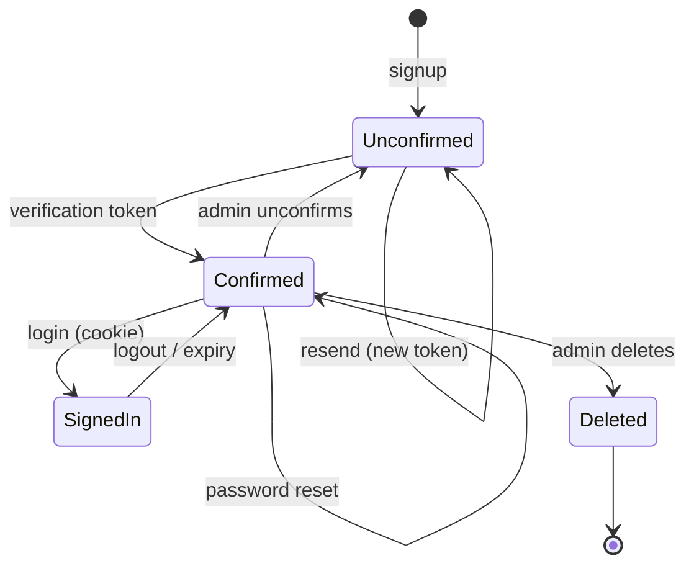

# Accounts & settings

Authentication is cookie-based: the backend issues a signed JWT and stores it in
an `HttpOnly` cookie. The frontend never holds the token in JavaScript.

## Signup

`POST /api/v1/user/signup` accepts:

```json
{
  "name": "Ada Lovelace",
  "email": "ada@example.com",
  "password": "a-strong-password",
  "password_confirmation": "a-strong-password"
}
```

Rules enforced by the API:

- name is required and at most 100 characters;
- email must be valid; signup returns the same answer for a new or existing
  address, so it cannot be used to enumerate accounts;
- password and confirmation must match;
- password must be at least 8 characters and contain an uppercase letter, a
  lowercase letter, a digit and a special character;
- a signup for a new address returns `201` and creates an **unconfirmed**
  account; an existing address gets the same response without creating a second
  account.

If the verification email cannot be delivered, signup still succeeds: the
account exists and the resend endpoint is the recovery path. The failure is
logged server-side instead of turning a successful signup into a retry that
would then be told the email is taken.

## Email verification

New accounts must be confirmed before they can log in.

1. Signup creates a random token. Only its **SHA-256** is stored in
   `email_verification_tokens`, so a database dump cannot be turned into working
   links.
2. The link points at `RUNCODES_PUBLIC_URL/verify-email?token=...` and expires
   after 24 hours.
3. Opening the link calls `POST /api/v1/user/verify-email`, which consumes the
   token and sets `users.confirmed = true`.
4. `POST /api/v1/user/login` refuses an unconfirmed account with `403`.
5. Every protected route also checks the `confirmed` flag, so a session issued
   before an account was unconfirmed stops working. Logout is deliberately
   exempt, so the browser can always drop the dead session.

Reissuing a link invalidates the previous one. `POST
/api/v1/user/resend-verification` always answers `202`, whether or not the
address belongs to an account, so it cannot be used to enumerate users. The
verification and recovery routes are rate limited to 10 requests per minute per
client IP.

In the local Compose stack, verification mail is caught by **smtp4dev** at
<http://localhost:8081>. For a real relay, configure `RUNCODES_SMTP_*`; see the
[configuration reference](../reference/configuration.md#mail).

## Password recovery

The login page's **Esqueceu a senha?** link opens `/forgot-password`, which calls
`POST /api/v1/user/forgot-password` with the account email. The route always
answers `202`, whether or not the address belongs to an account, so it cannot be
used to enumerate users.

1. The backend creates a random token and stores only its **SHA-256** in
   `password_reset_tokens`. The plaintext exists only in the emailed link.
2. The link points at `RUNCODES_PUBLIC_URL/reset-password?token=...` and expires
   after **1 hour**.
3. `/reset-password` asks for the new password and confirmation, then calls
   `POST /api/v1/user/reset-password`, which consumes the token and stores a new
   bcrypt hash.
4. The token is single use. Requesting another link invalidates the previous one.

The password policy is the same as signup. Resetting a password does not confirm
an unconfirmed account: the user still needs to open a verification link (the
login page offers a resend after the `403`).

## Sessions

| Property | Value |
| --- | --- |
| Cookie name | `jwt` |
| Flags | `HttpOnly`, `SameSite=Strict`, `Secure` (except debug mode) |
| Lifetime | 30 minutes, sliding |
| Algorithm | HS256 |
| Claims | `id`, `name`, `email`, `role`, `token_version`, `iat`, `exp` |
| Refresh | `POST /api/v1/auth/refresh` renews an active session |

The cookie is set by `POST /api/v1/user/login`; the response body is empty.
`GET /api/v1/auth` returns the current user and session expiry.
`POST /api/v1/user/logout` clears the cookie with `204`.

There is no server-side session store, but every token carries the account's
`token_version` and every protected request compares it with the database.
Changing the password, completing an email change, or having an admin change the
role/confirmation bumps the version, which invalidates every issued token.
Logout itself only clears the browser cookie, so a copied token remains valid
until it expires. The frontend calls the API with `credentials: "include"` and
relies on the cookie.

A cross-origin setup (for example `bun run dev` on `:5173` with the API on
`:8443`) is supported through `FRONTEND_ORIGIN`; credentials require an explicit
origin, never a wildcard.

## Password changes and legacy accounts

`PUT /api/v1/user/password` requires the current password and a confirmed new
password. The update bumps `token_version`, so the session cookie stops working
on the next request; sign in again with the new password.

Accounts imported from the legacy platform keep a
`legacy-sha1$<hex>` hash. On the first successful login, the backend verifies it
using `RUNCODES_LEGACY_PASSWORD_SALT` and transparently upgrades it to bcrypt.
Users created by the current system are unaffected by that variable.

## Profile

`GET`/`PUT /api/v1/user/profile` exposes and edits:

| Field | Editable | Notes |
| --- | --- | --- |
| `name` | yes | display name |
| `email` | yes, with the current password | two-step: `pending_email` then verification |
| `org_id` | yes | institutional identifier, unique when present |
| `code_editor_enabled` | yes | whether the in-browser editor is enabled |
| `role` | no | changed by an admin |
| `confirmed` | no | changed by verification or an admin |

An email change requires the current password and stores the new address as
`pending_email`; a verification link is sent there, and the account keeps the old
address until the link is used. Completing the change invalidates existing
sessions, so sign in again with the new address.

The profile page also exposes theme and editor preferences locally. The code
editor preference is stored on the account so it follows the user between
devices.

## Platform settings

Two settings are visible before login:

- `contact_email` — the support address shown on the login page;
- `contact_disclaimer_html` — an optional HTML notice.

They are stored in `platform_settings` and edited at `/admin/settings`. The
public route `GET /api/v1/settings/public` serves them without authentication.
The HTML is sanitized with DOMPurify in the browser.

## Account lifecycle at a glance



## Related pages

- [API: users & accounts](../api/auth.md)
- [Classes, roles & access](./classes-and-roles.md)
- [Configuration: mail](../reference/configuration.md#mail)
