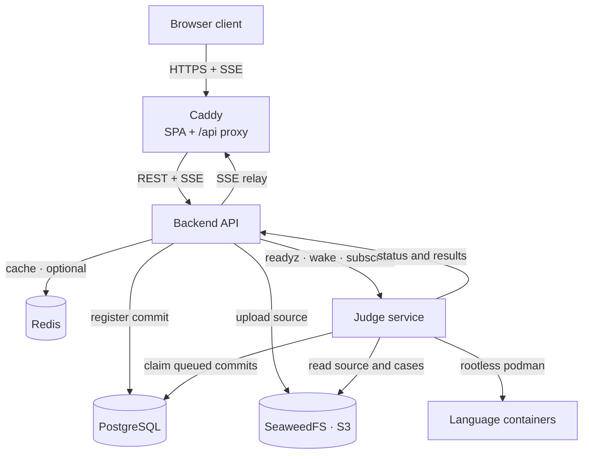
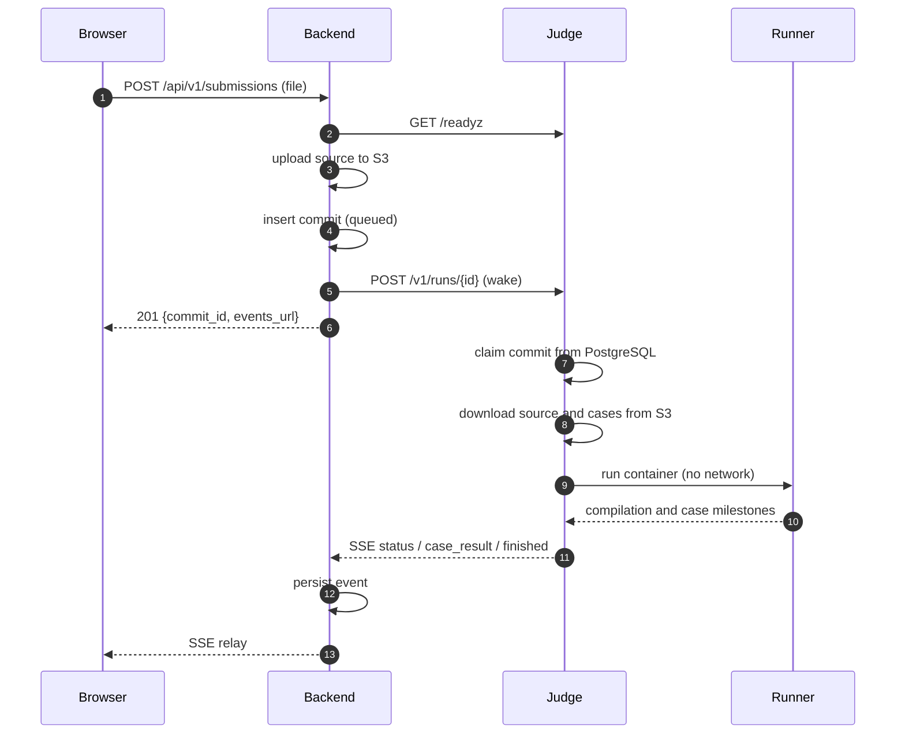
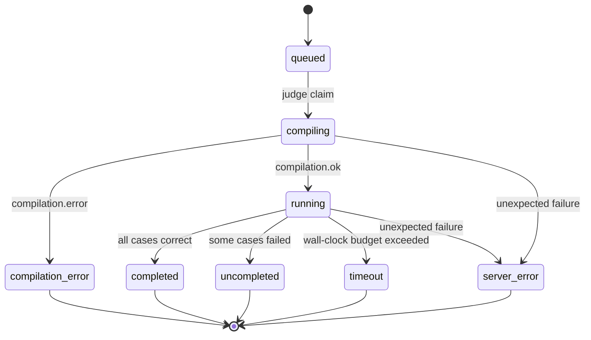

# Architecture

RunCodes separates the public web tier, the stateless API, the stateful data
tier, and the untrusted execution tier. The same shape is used locally with
Docker Compose and in the four-machine Ansible deployment.

## High-level topology

Only the frontend is published on a network interface in the local stack. The
backend, judge, SeaweedFS, database and mail catcher are bound to loopback. In
the four-machine deployment, Caddy is the only public process; every other port
binds to a private node address.

## Components

| Component | Runs on | Owns | Does not own |
| --- | --- | --- | --- |
| Frontend (Caddy) | public edge | TLS, the SPA bundle, `/api/*` and `/otel/v1/traces` proxying | application state |
| Backend | edge / app host | authentication, authorization, all Postgres writes, all S3 uploads, SSE relay | code execution |
| Judge | compute host | claiming commits, container lifecycle, grading, event stream | persistence, artifacts |
| PostgreSQL | data host | users, classes, exercises, commits, results, queue | files, source code |
| SeaweedFS | data host | submitted source, test-case I/O, exercise files, output archives | relational data |
| Redis | data host | cached responses | durable data |
| Runners | compute host | compiling and running one submission | orchestration |
| Monitor | inside a runner | per-process limits, CPU time, exit status | grading decisions |

## Submission lifecycle

1. The client uploads a source file to `POST /api/v1/submissions` as a multipart
   form (`exercise_id`, `file`; 10 MiB cap).
2. The backend validates the exercise, the deadline and the file extension,
   checks that the judge's `/readyz` is healthy, and uploads the source to the
   `<prefix>-commits` bucket in SeaweedFS.
3. In a single transaction, the backend inserts a `queued` commit and wakes the
   judge with `POST /v1/runs/{id}` **before committing**. If the wake fails, the
   transaction is rolled back and the uploaded object is deleted, so a
   submission is never registered without a judge that can run it.
4. A judge worker claims the commit from PostgreSQL with
   `SELECT ... FOR UPDATE SKIP LOCKED`, writing only the claim
   (`status = compiling`, `compilation_started = now()`). At most
   `JUDGE_CONCURRENCY` containers run at once.
5. The judge derives the language from the submission's file extension,
   downloads the source, the test cases and the exercise's compilation files,
   and creates a per-commit workspace under `JUDGE_EXEC_DIR`.
6. The language container is started with the workspace mounted at `/root`. The
   image's harness reads `container.config`, deletes it before any submitted code
   runs, and emits milestone lines carrying a per-run nonce.
7. Each test case is run through the monitor with the exercise's limits. The
   judge grades the outputs and streams `status`, `compilation`, `case_result`,
   `artifact` and `finished` events over SSE.
8. The backend persists every event and relays it to the browser. The stream
   starts with a `snapshot` of the persisted state, so a reload reconnects and
   catches up even after the judge has forgotten the run.

## Commit state machine

The commit lifecycle mirrors the legacy engine:

`queued` commits are durable. If a judge crashes after claiming a commit, the row
stays `compiling` or `running`; the backend's reconciliation sweeper marks rows
that exceed `RUNCODES_JUDGE_STALE_TIMEOUT` as `server_error`. Claiming itself is
crash-safe and multi-instance safe.

## Data and storage boundaries

| Data | Location | Durability |
| --- | --- | --- |
| Users, classes, exercises, commits, results | PostgreSQL | must be backed up |
| Submitted source, test cases, exercise files, output archives | SeaweedFS (`<prefix>-commits`, `-cases`, `-files`, `-outputfiles`) | must be backed up |
| Cached API responses | Redis | disposable |
| Judge workspaces | `JUDGE_EXEC_DIR` (`/exec` in Compose) | disposable |
| Telemetry | observability volumes | optional; retention-capped |

The backend logs in as `runcodes_app` and the judge as `runcodes_judge`; both
can read and write the rows they need but cannot change the schema, create roles
or read `pg_authid`. Only the database container and the migration tooling use
the owner role.

## Security boundaries

- **Public surface:** Caddy on 80/443. Everything else is private or loopback.
- **Trust boundary for untrusted code:** the runner container. The judge builds
  a Podman spec with cgroup limits, its own PID/UTS/IPC namespaces, **no network
  namespace**, `no-new-privileges`, and a single bind mount for the workspace.
- **Container identity:** every language image runs as an unprivileged
  `runcodes` user, never root. The judge doesn't depend on the uid, only on the
  shape: non-root and `$HOME=/root`.
- **Milestone integrity:** the harness deletes `container.config` before running
  submitted code and prefixes every progress milestone with a nonce, so a
  submission cannot fake `run.done`.
- **Grading trust:** the judge stops the container before grading, reads expected
  outputs from a private directory outside the workspace, refuses symlinks, and
  only reads the monitor report that was renamed into place after the process
  group was killed.

See [Judge](../services/judge.md) for the full isolation and limits discussion,
and [Deployment security](../deployment/security.md) for host hardening.

## Scale and failure domains

The reference deployment is **single-instance, four-host**: one edge, one data
host, one compute host and one observability host. It is production-shaped
(private networking, published images, encrypted secrets, retention limits) but
not highly available. PostgreSQL, SeaweedFS and the judge are single points of
failure for their respective functions; telemetry is a single point of failure
for observability only.

The natural scaling order is:

1. **Compute** — add judge hosts; the queue is already multi-instance safe.
2. **Observability storage** — move Prometheus/Loki/Tempo/Pyroscope to object
   storage or managed services.
3. **Data** — split SeaweedFS from PostgreSQL, then move to managed services.
4. **Edge** — run multiple stateless edge hosts behind a load balancer.

See [Security & scaling](../deployment/security.md) for the details.

## Request routing

In both deployment paths, the browser only talks to Caddy:

| Path | Destination | Purpose |
| --- | --- | --- |
| `/` | SPA static files | React application |
| `/api/*` | backend `:8443` | REST API and SSE |
| `/otel/v1/traces` (four-machine) | collector `:4318` | browser traces only |

Same-origin routing removes CORS from the normal path and means the frontend
image does not bake in a deployment-specific API URL. A separate frontend
origin (for example `bun run dev` on `:5173`) is supported through
`FRONTEND_ORIGIN` and `VITE_API_ENDPOINT`.
