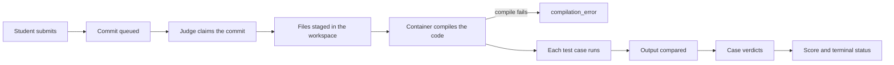

# How grading works

A submission moves through a fixed pipeline: the API queues it, a judge worker
compiles and runs it in a language container, each test case is compared against
the professor's expected output, and the results become a score. This page
explains that pipeline and the rules behind the numbers, so students can
interpret a verdict and professors can explain a grade.

## The run pipeline



The API stores the commit before any worker sees it. The judge claims a queued
commit with `FOR UPDATE SKIP LOCKED`, runs one container for the whole
submission, and streams one event per test case. PostgreSQL remains the source
of truth; the live stream is a view of what the judge reported. See
[Submissions & live judging](./submissions.md) for the event contract.

## Compilation

The judge derives the language from the file name and starts the matching
runner image. Compilable languages run a compile step first. If the compiler
fails, the run ends with **Erro de compilação** (`compilation_error`), no test
cases execute, and the score is 0. The compiler output is shown in the results
panel.

Interpreted languages skip the compile phase. A few languages marked as
compilable run a validation or bytecode step instead of a native compiler. The
[language matrix](../reference/languages.md#compilable-vs-interpreted) lists
which images compile.

## Test case execution

Every case receives:

- the test case input, as text or a file;
- extra files attached to the case;
- the exercise's compilation files, already present when the code was built;
- the limits configured for the case.

The program writes its standard output to a per-case file. Standard error is
kept as diagnostic output and does not by itself fail a case. A non-zero exit
status, a signal, a timeout, a resource limit or an unreadable output file fails
the case before the output comparison.

The per-case limits are:

| Limit | Unit | Effect |
| --- | --- | --- |
| CPU time limit | seconds | bounds the wall-clock execution time of the case |
| Memory | bytes | caps the address space of the process |
| Stack | bytes | caps the process stack |
| File size | bytes | caps a file the program writes |

The API calls the first field `cpu_time_limit_seconds`, but the harness enforces
it as a wall-clock timeout. The monitor reports the CPU time actually consumed,
which the results panel shows separately.

A limit of 0 means the platform default for that field. The judge also applies
deployment-wide cgroup caps and a maximum run duration. The judge's caps are a
backstop; the professor's per-case limits define the grading rules.

## Output comparison

The comparison depends on the type of the expected output the professor chose.

### Text cases

A case is **Correto** only when the program's output matches the expected output
after normalising lines and trailing whitespace:

- the output is split into lines;
- the last empty line is ignored, so a missing final newline is accepted;
- trailing whitespace on each line is ignored;
- the number of lines must match;
- each line must be equal otherwise.

Uppercase and lowercase are different. A blank line in the middle is a
difference. A different number of spaces between tokens is a difference.

When the strict comparison fails, the judge also runs a lenient comparison that
skips blank lines and compares whitespace-separated tokens case-insensitively.
That lenient result produces **Saída incorreta**, not **Correto**. The label
means the program ran but the output is not an exact match, whether the cause is
wrong content or formatting.

### File cases

A file expected output is compared byte for byte. No whitespace normalisation
applies.

### Failure verdicts

| Verdict | Cause |
| --- | --- |
| **Correto** | exact text match after normalisation, or byte-identical file |
| **Saída incorreta** | the program produced output, but it is not an exact match |
| **Interrompido** | non-zero exit, signal, timeout, resource limit or unreadable output |

## Score

The score is:

```text
score = 100 × (number of correct cases) / (total number of cases)
```

Only **Correto** cases count. A case with **Saída incorreta** or
**Interrompido** counts as zero. The score is a percentage between 0 and 100 and
is stored with two decimals. The judge also stores the number of correct cases.

An exercise with no test cases has nothing to grade: the judge reports
**Não concluído** with score 0. The API normally refuses a submission to an
exercise without test cases, so this only affects old queued work.

The terminal status is:

| Status | Meaning |
| --- | --- |
| **Concluído** (`completed`) | every case was correct |
| **Não concluído** (`uncompleted`) | at least one case was not correct |
| **Erro de compilação** (`compilation_error`) | the compiler rejected the code; score 0 |
| **Erro no servidor** (`server_error`) | the judge or an infrastructure dependency failed |
| **Tempo esgotado** (`timeout`) | the run exceeded the deployment's run budget |

A `server_error` or `timeout` is not a verdict on the code. The student can
resubmit, and a professor can ask an administrator to check the judge.

## Best score and class grade

Students and professors see the aggregation from different sides. A student sees
their best score per exercise and an average over the exercises that have a
score. A professor sees the class grade, which also counts exercises without a
submission.

### Per exercise

The grade on an exercise is the **best score among the student's
submissions**, not the latest one. The class page shows that best score, and the
history lists every submission with its own score.

A submission that is still queued, compiling or running has no final score yet.
Until it finishes, it contributes 0 to the aggregates.

### Per class

The professor-facing class grade for a student is the mean of the student's best
score on every exercise in the class:

```text
class grade = sum(best score on each exercise) / number of exercises
```

An exercise without a submission counts as zero. The class grade therefore
reflects missed work, not only attempted work. Removed exercises are excluded
from the gradebook.

The gradebook is available to the class owner and co-professors in the class's
**Notas** tab. It shows:

- one row per enrolled, non-banned student;
- one column per non-removed exercise;
- the best score per cell and the submission count when there is more than one;
- the class grade per student;
- class and per-exercise statistics.

The class statistics use the same rows:

| Statistic | Definition |
| --- | --- |
| Students | enrolled, non-banned accounts with the student role |
| Students with submission | students with at least one submission |
| Class average | mean of the students' class grades |
| Above 50 | students whose class grade is **greater than** 50 |
| Exercise average | mean of the exercise's best scores over every student, missing as zero |
| Average among submitters | mean over the students who submitted |
| Approval rate | percentage of students above 50 on that exercise |
| Best / lowest | highest and lowest best score on the exercise |

The CSV export contains the same table, plus the submission count and the last
submission time. A cell with no submission is empty in the CSV, while the class
grade column still counts it as zero. This distinguishes "did not submit" from
"submitted and scored zero".

## Recompilation

A professor can recompile a class after fixing or changing test cases. The
operation creates a new commit for the latest submission of each student on each
exercise; it does not overwrite the old commit. The old result stays in the
history and the new run appears as a new submission.

Because the gradebook uses the best score, a recompilation can raise a grade but
cannot lower the best score that was already recorded. The class page continues
to show the best score while the new run is pending.

## What is not part of the grade

- **Code style and comments.** The judge compares output, not source quality.
- **Standard error.** Warnings on standard error do not fail a correct case.
- **Output files beyond the compared output.** The output archive is available
  for download, but it does not change the score.
- **Submission count.** Recompilations and resubmissions do not produce extra
  credit; only the best score counts.
- **Timing beyond the limits.** A slower but correct program within the limit
  receives the same score as a faster one.

## Where to go next

- [Student guide](./student-guide.md) explains how to read the result panel.
- [Professor guide](./professor-guide.md) explains how to configure cases and
  export grades.
- [Submissions & live judging](./submissions.md) covers statuses and events.
- [Judge](../services/judge.md) documents the execution engine.
