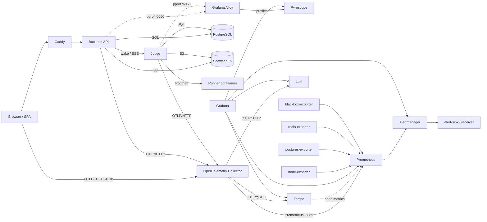

# Observability overview

RunCodes ships an opt-in observability stack built on OpenTelemetry. The backend
and judge emit traces, metrics and structured logs; the browser emits fetch
traces; Alloy scrapes pprof profiles from both Go services. A collector fans the
signals out to Tempo, Loki, Prometheus and Pyroscope, and Grafana ties them
together.

Instrumentation is **off by default**. The services export nothing unless
`OTEL_EXPORTER_OTLP_ENDPOINT` is set. `docker compose up` has no telemetry
dependency; the overlay adds it without changing the application's behaviour.

## Pillars

| Pillar | Component | Role |
| --- | --- | --- |
| Collection | OpenTelemetry Collector (contrib) | OTLP gateway for traces, metrics and logs |
| Metrics | Prometheus | application, trace-derived and infrastructure metrics |
| Logs | Loki | OTel application logs, queryable by service and trace |
| Traces | Grafana Tempo | distributed traces + span metrics / service graph |
| Visualisation | Grafana | dashboards, Explore, cross-signal correlation |
| Alerting | Alertmanager + Prometheus rules | routing, grouping, inhibition, webhooks |
| Instrumentation | OpenTelemetry Go and Web SDKs | Go traces/metrics/logs; browser fetch traces |
| Profiles | Pyroscope + Alloy | continuous pprof profiles from backend and judge |

## Architecture

## What is instrumented

### Backend

- inbound HTTP spans (`otelchi`), outbound judge/S3 HTTP spans (`otelhttp`), and
  database spans (`otelsql`);
- HTTP server metrics using the chi route pattern, not the raw path;
- `TraceId` and `X-Trace-Sampled` response headers;
- structured logs with `trace_id`/`span_id`, forwarded as OTLP logs to Loki;
- optional pprof listener for Alloy/Pyroscope, with `otel-profiling-go` linking
  spans to flame graphs.

### Judge

- `judge.process_commit` root span per claimed commit, keyed by
  `runcodes.commit.id`;
- `judge.prepare_workspace`, `judge.run_container`, and one
  `judge.grade_test_case` span per case (verdict, CPU time, memory);
- queue gauges `runcodes.judge.queue.depth` and
  `runcodes.judge.queue.oldest_age`;
- S3 downloads, database claims, OTLP logs and pprof.

### Browser

- opt-in at build time (`VITE_OTEL_ENABLED=true`);
- `FetchInstrumentation` creates a span per API call and injects `traceparent`;
- the backend continues the trace, so a click becomes one trace spanning the
  browser, Caddy, backend, judge, PostgreSQL and S3;
- only traces are exported from the browser.

### Infrastructure

- node-exporter on each host;
- postgres-exporter and redis-exporter on the data host;
- blackbox-exporter probes for the public frontend and service health endpoints;
- Tempo's metrics-generator produces span metrics and service graphs and
  remote-writes them to Prometheus.

## Correlation paths

| From | To | How |
| --- | --- | --- |
| Metrics | Traces | Prometheus exemplar mapping (`trace_id` → Tempo) |
| Traces | Logs | Tempo `tracesToLogsV2` selects Loki `{service_name="…"} \| trace_id="…"` |
| Logs | Traces | Loki derived field on `trace_id` structured metadata |
| Traces | Metrics | Tempo `tracesToMetrics` maps `service.name` to the Prometheus `service_name` label |
| Browser | Backend/judge | `traceparent` injection and continuation |
| Spans | Profiles | `pyroscope.profile.id` attribute and trace/span labels on pprof samples |
| Dashboard | All | the `service` template variable filters by OTel `service.name` |

The backend also returns a `TraceId` header, so an API user can report a trace id
and an operator can open it directly in Tempo.

## Components and versions

Versions are pinned in `docker-compose.observability.yml` and in
`scripts/observability/validate.sh`. Pin them together.

| Component | Image | Persistence |
| --- | --- | --- |
| `otel-collector` | `otel/opentelemetry-collector-contrib:0.163.2` | none |
| `prometheus` | `prom/prometheus:v3.15.1` | `prometheus-data` (15d / 8 GB) |
| `alertmanager` | `prom/alertmanager:v0.34.1` | `alertmanager-data` |
| `loki` | `grafana/loki:3.7.9` | `loki-data` (7d) |
| `tempo` | `grafana/tempo:3.1.1` | `tempo-data` (7d) |
| `grafana` | `grafana/grafana:12.4.13` | `grafana-data` (SQLite) |
| `node-exporter` | `prom/node-exporter:v1.12.1` | none |
| `postgres-exporter` | `prometheuscommunity/postgres-exporter:v0.20.1` | none |
| `redis-exporter` | `oliver006/redis_exporter:v1.95.0` | none |
| `blackbox-exporter` | `prom/blackbox-exporter:v0.29.1` | none |
| `pyroscope` | `grafana/pyroscope:2.4.1` | `pyroscope-data` (7d) |
| `alloy` | `grafana/alloy:v1.21.1` | `alloy-data` |
| `alert-sink` | `python:3.14-slim-trixie` | in-memory (last 100 payloads) |

## Two ways to run it

| | Local overlay | Four-machine deployment |
| --- | --- | --- |
| Command | `make observability-up` | `deploy/ansible` observability stage |
| Hosts | one | dedicated observability host + agents on edge/compute/data |
| Ingress | `localhost:4318` | private `:4318`, browser path via Caddy |
| Access | localhost UIs | SSH tunnel / private network |
| Intended use | development, demos | production-shaped reference |

- [Local stack](./local.md) — commands, ports and configuration.
- [Four-machine deployment](./production.md) — signal routing, alerts, retention.
- [Runbook](./runbook.md) — validation, failure modes and queries.

## Known limitations

- **Browser tracing is build-time.** A build without `VITE_OTEL_ENABLED=true`
  emits no browser spans.
- **Profiles are CPU-only and sampling-dependent.** A span shorter than ~20 ms
  may have no samples even when the profile link exists.
- **Judge internals are coarse.** The container's internal compile/test loop is
  one `judge.run_container` span; the API, DB, S3 and per-case spans are finer.
- **Only application logs go to Loki.** Infrastructure logs stay in the Podman
  journal / `podman-compose logs`.
- **Single-node storage, no HA, no TLS.** The overlay is for development; the
  four-machine deployment is private and retention-capped but still single-node.
- **Alerting is a webhook.** The bundled sink is a test fixture, not a paging
  product.
- **No metamonitoring.** A down observability host is detected by users, not by a
  second watcher.

## Related pages

- [Configuration: observability](../reference/configuration.md#observability)
- [CI/CD](../ci-cd.md)
- [Runbook](./runbook.md)
