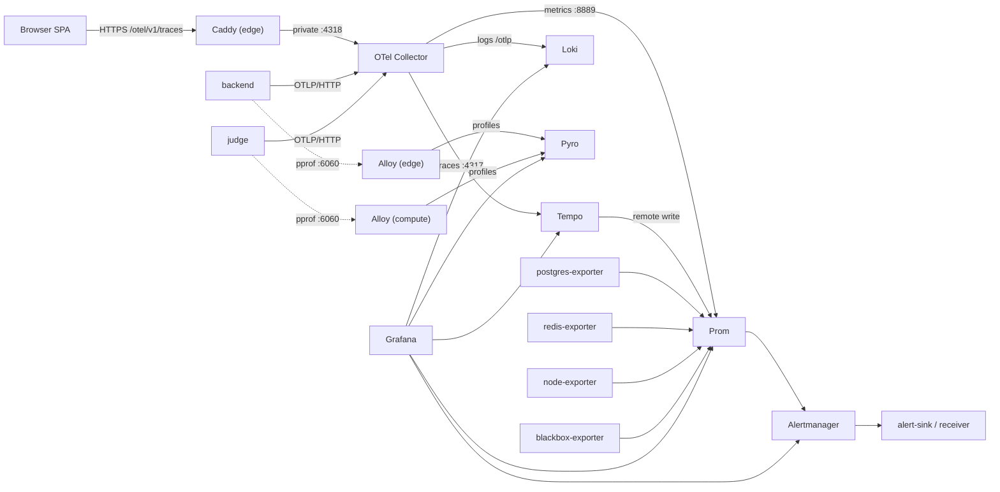

# Four-machine observability

The four-machine deployment ships the full instrumentation the application
already emits: traces, metrics, logs, continuous CPU profiles and alerts. This
page describes the deployed variant; the local stack is in
[Local observability stack](./local.md).

## Signal inventory

| Signal | Source | Collection | Storage | Query |
| --- | --- | --- | --- | --- |
| Traces | backend, judge, browser SPA | OTel Collector | Tempo | Grafana Explore / Tempo API |
| Application metrics | backend, judge | collector Prometheus exporter | Prometheus | Grafana / PromQL |
| Host metrics | all four hosts | node-exporter | Prometheus | Grafana / PromQL |
| Database metrics | PostgreSQL | postgres-exporter | Prometheus | Grafana / PromQL |
| Cache metrics | Redis | redis-exporter | Prometheus | Grafana / PromQL |
| Availability | frontend, backend, judge, observability services | blackbox-exporter | Prometheus | Grafana / PromQL |
| Application logs | backend, judge | OTel logs → collector → Loki | Loki | Grafana / LogQL |
| CPU profiles | backend, judge pprof | Alloy → Pyroscope | Pyroscope | Grafana / span profiles |
| Alerts | Prometheus rules + Grafana-managed rule | Alertmanager | Alertmanager / receiver / alert-sink | Alertmanager UI, webhook |
| Dashboards | provisioned JSON | Grafana provisioning | Grafana SQLite | Grafana |

The in-container monitor is not a separate telemetry service. Its per-case
results become judge spans and metrics.

## Where everything runs

| Host | Observability components | Exposed on |
| --- | --- | --- |
| edge | node-exporter, Alloy (backend pprof) | `private_ip:9100`, `private_ip:12345` |
| data | node-exporter, postgres-exporter, redis-exporter | `:9100`, `:9187`, `:9121` |
| compute | node-exporter, Alloy (judge pprof) | `:9100`, `:12345` |
| observability | collector, Prometheus, Alertmanager, alert-sink, Loki, Tempo, Pyroscope, Grafana, node/blackbox exporters | private ports below |

Collector and storage ports:

| Port | Service | Notes |
| --- | --- | --- |
| 4317 | OTLP/gRPC | private; future/internal exporters |
| 4318 | OTLP/HTTP | backend, judge, edge proxy, smoke test |
| 13133 | collector health | `/health/status` |
| 8888 | collector self-metrics | Prometheus scrape |
| 8889 | application metrics | Prometheus scrape |
| 9090 | Prometheus | UI/API, remote-write receiver |
| 9093 | Alertmanager | UI/API |
| 8085 | alert-sink | test receiver |
| 3100 | Loki | API; `/ready` |
| 3200 | Tempo | API; `/ready` |
| 4040 | Pyroscope | API/UI; `/ready` |
| 3000 | Grafana | UI; private, use an SSH tunnel |
| 9100 | node-exporter | Prometheus scrape |
| 9115 | blackbox-exporter | Prometheus probe endpoint |

Every port binds to `private_ip`. The only telemetry traffic that crosses the
public interface is the edge Caddy route `POST /otel/v1/traces`.

## Cross-host data flow



The collector is the single OTLP ingress. Prometheus is the single scraper.
Alloy is the only component that pulls pprof, and it runs on the host whose
compose network contains the listener.

## Application instrumentation

The deployment sets the same variables on the backend and judge:

| Variable | Value | Meaning |
| --- | --- | --- |
| `OTEL_EXPORTER_OTLP_ENDPOINT` | `http://<obs private ip>:4318` | enables export |
| `OTEL_EXPORTER_OTLP_PROTOCOL` | `http/protobuf` | OTLP/HTTP |
| `OTEL_SERVICE_NAME` | `runcodes-backend` / `runcodes-judge` | `service.name` |
| `OTEL_SERVICE_VERSION` | `config_runcodes_version` | `service.version` |
| `DEPLOYMENT_ENVIRONMENT` | `config_runcodes_environment` | environment |
| `OTEL_TRACES_SAMPLER` | `config_runcodes_otel_traces_sampler` | sampler |
| `OTEL_TRACES_SAMPLER_ARG` | `config_runcodes_otel_traces_sampler_arg` | ratio |
| `OTEL_METRIC_EXPORT_INTERVAL` | 10000 ms | metric cadence |
| `OTEL_BSP_SCHEDULE_DELAY` / `OTEL_BLRP_SCHEDULE_DELAY` | 2000 ms | batch delays |
| `PPROF_ADDR` | `:6060` | internal pprof for Alloy |
| `OTEL_SDK_DISABLED` | `false` | kill switch |

The backend returns `TraceId` and `X-Trace-Sampled`; the smoke test uses them to
follow one exact trace.

For production volume, set `runcodes_otel_traces_sampler:
parentbased_traceidratio` and a ratio such as `0.1`. The smoke test may then miss
its exact trace; run it with the always-on sampler or accept retries.

## Browser tracing and the public OTLP path

The SPA is built with:

```text
VITE_OTEL_ENABLED=true
VITE_OTEL_EXPORTER_OTLP_ENDPOINT=/otel
VITE_OTEL_SERVICE_NAME=runcodes-frontend
VITE_OTEL_SERVICE_VERSION=<runcodes_version>
VITE_DEPLOYMENT_ENVIRONMENT=<runcodes_environment>
VITE_OTEL_TRACES_SAMPLER_ARG=<runcodes_otel_traces_sampler_arg>
```

The exporter appends `/v1/traces`, so it posts to
`https://<domain>/otel/v1/traces` on the SPA origin. Caddy matches that exact
path, strips `/otel`, and proxies to the private collector `:4318`:

```caddyfile
handle /otel/v1/traces {
    uri strip_prefix /otel
    reverse_proxy <observability private ip>:4318
}
```

Because the request is same-origin, there is no CORS preflight in the normal
path. Caddy caps the body at 4 MiB. Only traces are proxied; metrics and logs
from browsers would be a much larger unauthenticated ingestion surface.

The backend continues the browser's `traceparent`, so a click becomes one trace
spanning browser, Caddy, backend, judge, S3 and PostgreSQL.

## Metrics: scrape jobs and exporters

Prometheus scrapes:

| Job | Targets | Source |
| --- | --- | --- |
| `prometheus` | `localhost:9090` | self |
| `otel-collector` | `otel-collector:8889` | application metrics |
| `otel-collector-internal` | `otel-collector:8888` | collector queue/drop metrics |
| `alertmanager` | `alertmanager:9093` | alerting |
| `loki` | `loki:3100` | log storage |
| `tempo` | `tempo:3200` | trace storage |
| `grafana` | `grafana:3000` | dashboards |
| `pyroscope` | `pyroscope:4040` | profiles |
| `node-exporter` | all four hosts `:9100` | CPU, memory, disk, network |
| `postgres-exporter` | data `:9187` | `pg_up`, connections, stats |
| `redis-exporter` | data `:9121` | `redis_up`, memory, clients |
| `alloy` | edge/compute `:12345` | profiler health/write metrics |
| `blackbox-http` | frontend, health endpoints, Grafana/Loki/Tempo/Alertmanager/Prometheus/Pyroscope | synthetic availability |

The collector's Prometheus exporter adds `service_name` and other
low-cardinality OTel resource attributes as labels, so application metrics can
be grouped by service without joining `target_info`.

The judge exports `runcodes_judge_queue_depth` and
`runcodes_judge_queue_oldest_age_seconds` from its PostgreSQL queue. Tempo's
metrics-generator remote-writes span metrics and service graphs to Prometheus.

Alert rules live in `observability/prometheus/rules/runcodes-alerts.yml` and are
copied to `/opt/runcodes/config/observability/rules/`. Prometheus is restarted by
an Ansible handler when rules or scrape config change.

## Logs, traces and profiles

### Logs

The backend and judge write structured logs to stdout **and** forward them as
OTLP log records. The collector sends them to Loki's OTLP endpoint. OTel attaches
`trace_id`/`span_id`, which Loki stores as structured metadata; Grafana derives a
"View trace in Tempo" link from `trace_id`.

Only application logs are shipped. PostgreSQL, Redis, SeaweedFS, Caddy and the
observability containers log to the Podman journal; use
`podman-compose ... logs` or `journalctl --user`.

### Traces

The collector exports traces to Tempo over OTLP/gRPC. Data includes:

- inbound HTTP (`otelchi`) and outbound HTTP (`otelhttp`) spans;
- database spans (`otelsql`) for claims, queries and updates;
- `judge.process_commit` and per-case `judge.grade_test_case` spans;
- S3 uploads/downloads;
- browser fetch spans, continued by the backend.

Tempo's metrics-generator produces span metrics and a service graph and
remote-writes them to Prometheus. Grafana's Tempo datasource has trace-to-logs,
trace-to-metrics and trace-to-profiles links provisioned.

### Profiles

Alloy on the edge scrapes `backend:6060`; Alloy on compute scrapes `judge:6060`.
Both write to Pyroscope on the observability host. The pprof listeners are never
published. The `otel-profiling-go` bridge adds `trace_id`/`span_id` labels to
profiles and `pyroscope.profile.id` to spans, so a span in Grafana can open its
matching flame graph. Short spans may have no CPU samples.

## Alerting

Prometheus evaluates the rules and sends firing alerts to Alertmanager. The
default route delivers to the URL in
`/opt/runcodes/secrets/alertmanager_webhook_url`:

- if `vault_alertmanager_webhook_url` is set, that is the real receiver;
- if it is empty, Ansible writes the alert-sink URL, so alerts are still
  delivered locally for validation.

When `config_runcodes_alertmanager_gmail_enabled` is true, the `default`
receiver also emails alerts through the configured Gmail/Workspace SMTP host
(`smtp.gmail.com:587` by default), and webhook delivery continues. The Google
app password is mounted from
`/opt/runcodes/secrets/alertmanager_gmail_app_password`; see
[Ansible setup](../deployment/ansible-setup.md#gmail-alert-email) for the
variables and [Ansible operations](../deployment/ansible-operations.md#alerts-do-not-arrive-at-the-receiver)
for SMTP failure modes.

The `ObservabilitySmokeTest` alert is always routed to the `alert-sink` receiver,
so `verify.yml` can prove the full rule → Alertmanager → webhook path without
touching the production receiver. Critical alerts get a shorter group wait, and
warning/critical alerts for the same service/name are inhibited by the critical
one.

Rules cover:

- observability target down (any scrape job);
- failing blackbox probes;
- backend/judge 5xx rate and p95 latency;
- trace error ratio from Tempo span metrics;
- judge queue depth and stalled queue;
- no profiles arriving;
- PostgreSQL down and connections high;
- Redis down;
- host root filesystem below 15% free;
- collector export failures.

Grafana also provisions one example Grafana-managed rule and an Alertmanager
contact point to exercise unified alerting. The Prometheus rules are the source
of truth.

## Access and dashboards

Grafana, Prometheus, Alertmanager, Loki, Tempo and Pyroscope are **private**. Use
an SSH tunnel through the edge:

```bash
ssh -L 3000:203.0.113.13:3000 \
    -L 9090:203.0.113.13:9090 \
    -L 9093:203.0.113.13:9093 \
    -L 4040:203.0.113.13:4040 \
    runcodes@<edge-public-address>
```

| URL | Purpose |
| --- | --- |
| <http://localhost:3000> | Grafana; home dashboard `runcodes-overview` |
| <http://localhost:9090> | Prometheus targets, queries, rules |
| <http://localhost:9093> | Alertmanager silences/status |
| <http://localhost:4040> | Pyroscope profiles |

The Grafana admin user is `config_runcodes_grafana_admin_user` (default
`admin`); the password is `vault_grafana_admin_password`. The dashboard includes
service request rate/errors/latency, logs, span metrics, host/database resources
and links to Explore. The `service` template variable filters by OTel
`service.name`.

Do not expose these ports through Caddy. They have no authentication (except
Grafana's login) and contain request metadata, SQL statements (without
parameters), user ids and email addresses.

## Validation

```bash
cd deploy/ansible
ansible-playbook playbooks/verify.yml --ask-vault-pass
```

The playbook waits for every service, asserts every active Prometheus target is
`up`, asserts every blackbox probe is 1, checks backend metrics and the judge
queue gauge, and runs the upstream smoke test from the observability host.

Manual checks through the tunnel:

```bash
# Targets
curl -s http://localhost:9090/api/v1/targets \
  | jq -r '.data.activeTargets[] | "\(.labels.job)\t\(.health)\t\(.lastError // "")"'

# Application metrics
curl -sG http://localhost:9090/api/v1/query \
  --data-urlencode 'query=sum(http_server_request_duration_seconds_count{service_name="runcodes-backend"})' \
  | jq '.data.result[0].value'

# Judge queue
curl -sG http://localhost:9090/api/v1/query \
  --data-urlencode 'query=runcodes_judge_queue_depth' | jq -c '.data.result'

# Logs
curl -sG http://localhost:3100/loki/api/v1/labels | jq '.data'
curl -sG http://localhost:3100/loki/api/v1/query_range \
  --data-urlencode 'query={service_name="runcodes-backend"} |= "error"' \
  --data-urlencode "start=$(( $(date +%s) - 900 ))" \
  --data-urlencode "end=$(date +%s)" --data-urlencode 'limit=20' | jq '.data.result | length'

# Trace by id
curl -s -o /dev/null -w '%{http_code}\n' http://localhost:3200/api/traces/<32-hex-trace-id>

# Profiles
curl -s http://localhost:4040/ready
curl -s http://<edge-private>:12345/-/ready
```

A complete trace id comes from the backend response header:

```bash
curl -sD - -o /dev/null http://<edge-private>:8443/api/v1/settings/public | grep -i traceid
```

## Adding a service or signal

This deployment is fixed at four machines, but a new service or exporter can be
added to an existing host:

1. **Application telemetry** — set the same `OTEL_EXPORTER_OTLP_ENDPOINT` and
   `OTEL_SERVICE_NAME` on the new service. If it is a Go service with pprof, set
   `PPROF_ADDR=:6060`, add it to the edge/compute Alloy target list, and restart
   Alloy.
2. **Host metrics** — run node-exporter on a new host and add the target to the
   `node-exporter` job in `roles/rc-observability/templates/prometheus.yml.j2`.
3. **Metrics exporter** — add a scrape job (with a `node` label) and a blackbox
   probe if it has a health endpoint.
4. **Alerts** — add rules to `observability/prometheus/rules/runcodes-alerts.yml`;
   validate with `promtool check rules`.
5. **Dashboard** — provision it from `observability/grafana/dashboards/`, never
   only in the UI.
6. **Logs** — emit OTel logs. The current Loki pipeline is application OTLP only.

## Retention and capacity

| Store | Default retention | Guardrail |
| --- | --- | --- |
| Prometheus | 15 days | 8 GB retention size (whichever first) |
| Loki | 7 days (168h) | compactor retention |
| Tempo | 7 days | `runcodes_tempo_retention_hours`; 1h compacted blocks |
| Pyroscope | 7 days | local filesystem volume |
| Grafana | SQLite volume | dashboards/provisioning in git |
| Alertmanager | state volume | notification log/state |

The observability host needs free space beyond these caps for WAL and
compactions; 200–400 GB SSD is a reasonable starting point. Monitor
`node_filesystem_avail_bytes` and the disk alert. For longer retention, move
Loki/Tempo/Pyroscope to object storage and Prometheus to remote write.

## Security

- The collector, Prometheus, Alertmanager, Loki, Tempo, Pyroscope and Grafana
  have no authentication beyond Grafana's login. Keep them private; use a
  VPN/SSH tunnel or an authenticating reverse proxy with SSO.
- OTLP is plaintext on the private network. If the network is untrusted, use
  WireGuard/IPsec or enable TLS/mTLS on the receivers.
- The public browser path is unauthenticated OTLP traces only. Rate-limit/WAF
  `/otel/v1/traces` on a hostile public deployment, or disable browser telemetry.
- Profiles expose heap, goroutine, CPU and command-line data. Never publish
  `:6060`.
- Loki logs may contain user ids, emails and request paths. Restrict Grafana and
  the Loki API.
- Grafana anonymous access, sign-up and plugin downloads are disabled.
- Alertmanager receiver credentials live in files, not YAML.

## Known limitations

- **Single-node storage, no HA.** If the observability host dies, telemetry is
  unavailable; the application keeps serving and OTLP retries/drops.
- **No object storage.** Retention is bounded by local disk.
- **Only application logs.** Infrastructure logs stay in the Podman journal.
- **Coarse judge internals.** The container's compile/test loop is one span.
- **Browser tracing is build-time.**
- **Span profiles are sampling-dependent.**
- **Alerting is a webhook** to a receiver; the bundled sink is a test fixture.
- **No metamonitoring.** A down observability host is detected by users.
- **No configuration drift detection.** Use git and Ansible diffs.

## Related pages

- [Runbook](./runbook.md)
- [Ansible setup](../deployment/ansible-setup.md)
- [Security & scaling](../deployment/security.md)
- [Original four-machine observability guide](https://github.com/reisaraujo-miguel/runcodes/blob/main/deploy/ansible/docs/OBSERVABILITY.md)
