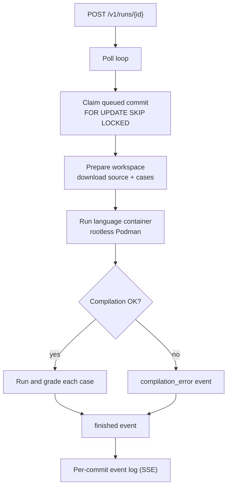
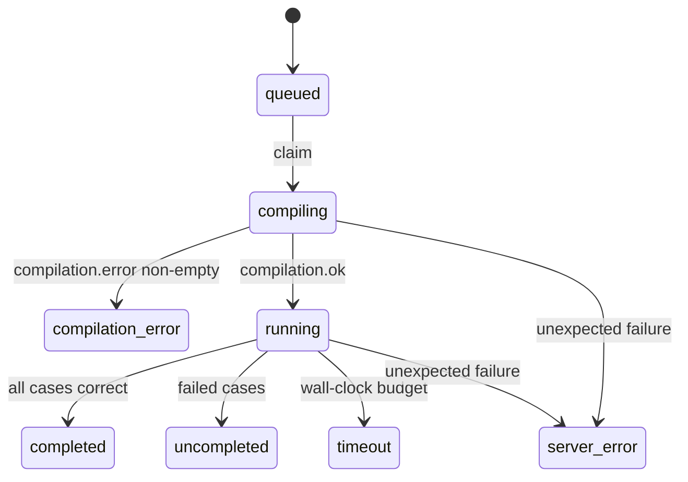

# Judge

The judge is the execution engine for submissions. It is the successor to the
legacy Python `compiler-engine` and runs the language images from `runners/`
with **rootless Podman** instead of Docker.

It is **compute-only**: it claims queued commits from PostgreSQL, reads its
inputs from SeaweedFS, runs the matching language container, grades the output,
and streams events to the backend over SSE. It never writes results or uploads
artifacts; the backend owns all persistence.

## How a submission flows

1. The backend registers a `queued` commit — committed, so the claim can see it —
   uploads the source and test-case files to SeaweedFS, and only then calls
   `POST /v1/runs/{id}` to wake the judge.
2. A worker claims the commit from PostgreSQL with
   `SELECT ... FOR UPDATE SKIP LOCKED`, writing only the claim
   (`status = compiling`, `compilation_started = now()`). At most
   `JUDGE_CONCURRENCY` containers run at once, and no submission is lost.
3. The worker prepares a per-commit workspace, mounts it into the language
   image at `/root`, and drives the image's script through the
   `compilation.start/done` and `run.start/done` milestones.
4. Every status change, per-case verdict and the terminal `finished` event is
   published to a replayable, per-commit event log. The backend consumes it with
   `GET /v1/runs/{id}/events`.



## The queue

PostgreSQL is the durable queue. The claim is:

```sql
UPDATE commits SET status = 'compiling', compilation_started = now()
WHERE id = (
  SELECT id FROM commits WHERE status = 'queued'
  ORDER BY created_at
  FOR UPDATE SKIP LOCKED
  LIMIT 1
)
RETURNING id;
```

The judge only ever writes this claim. Postgres keeps the row safe across judge
crashes and allows multiple judge instances to claim different commits without
coordination.

The poll loop wakes on `POST /v1/runs/{id}` (idempotent) and otherwise polls
every `JUDGE_POLL_INTERVAL` (default 1s). The wake endpoint is an optimization;
the durable queue does the real work.

The ordering matters: the claim reads committed rows, so the backend wakes the
judge **after** committing. A wake sent while the row is still in an open
transaction is always a no-op — the judge drains an empty queue and the
submission waits for the next poll tick, which is exactly the queue latency the
statistics report used to show. A failed wake is not a failed submission either:
the row stays `queued` and the next poll claims it.

## State machine



`case_result.status` maps to the database enum `correct`,
`bad_formatted_output`, or `killed_with_signal`. `finished.status` maps to
`completed`, `uncompleted`, `compilation_error`, `server_error`, or `timeout`.
The score is a percentage in `[0, 100]`.

## Endpoints

| Method | Path | Description |
| --- | --- | --- |
| GET | `/healthz` | liveness |
| GET | `/readyz` | PostgreSQL + Podman reachable (backend pre-check) |
| POST | `/v1/runs/{id}` | wake the poll loop for a commit |
| GET | `/v1/runs/{id}/events` | replayable SSE stream (`?from=<seq>`) |

Generated files are not served by the judge: it uploads them to the
`-outputfiles` bucket and the backend serves them to the author. The runner image
collects each case's files under `outputfiles/case_<id>/`, a directory it creates
even when the case wrote nothing. An image from before that step leaves no
directory, and the judge warns once per run that the runner images must be
rebuilt — the files themselves are gone with the case's scratch directory.

A case interrupted by a limit or a signal publishes no files. The program was
killed mid-write, so the collected bytes are a truncated file (exactly at the
file-size limit, when that is what killed it) and are not a result the student
should download.

Uploads run on four background workers, not on the goroutine that reads the
container's milestones: a large file must not delay the next case's result. Each
finished upload publishes an `artifact` event, so the download appears while the
suite is still running.

A case's collected files are moved out of the run's workspace into
`pending_<commit>/`, where they wait for their upload. The move is a rename, and it
keeps the upload backlog out of the run's workspace quota, which is sized for the
program, not for the judge's queue. The queue holds a burst of cases and refuses
deeper backlogs, and a request never makes the log stream wait: a slow store costs
that case's download, not the run's progress.

The terminal `finished` event is sent as soon as grading ends, before the upload
queue drains: a slow store never keeps the run looking unfinished. The uploads
finish in the background, and the last `ready` events can therefore arrive after
the stream closed — a client that showed the `pending` placeholder polls the
listing until the file appears.

A store that fails does not stall the run either: after three consecutive upload
failures the judge stops publishing for that commit, logs why and finishes. The
pending area is removed when the run closes, and the sweeper reclaims one left
behind by a crashed judge.

`/v1` requires `Authorization: Bearer $JUDGE_AUTH_TOKEN` (or
`RUNCODES_JUDGE_TOKEN`). While no token is configured, every `/v1` request is
refused with `503` instead of being served to anyone who can reach the port,
because the API exposes other people's submissions and outputs. A local-only
instance can opt out with `JUDGE_ALLOW_INSECURE=true`; the judge logs a warning.

The full event schema is in [Judge API](../api/judge.md).

## Container contract

The workspace is bind-mounted at `/root`. The image's `CMD /usr/bin/runcodes`
sources `container.config` from there. The judge writes:

```ini
monitor_max_fs=5242880        # JUDGE_MONITOR_MAX_FILE_SIZE
monitor_max_ms=268435456      # JUDGE_MONITOR_MAX_MEM_SIZE
compilation_timeout=60        # JUDGE_DEFAULT_COMPILATION_TIMEOUT, always written
run_nonce='7f3c…'
src_file='submission.c'       # or the selected entry point inside a zip
t_<case_id>=5                 # wall-clock seconds for the case
ms_<case_id>=67108864         # address space, 0 = no limit
fs_<case_id>=1048576          # file size, 0 = no limit
stack_<case_id>=1048576       # stack, 0 = the system default
```

Every key is written on every run, including a byte limit of `0`: the images
carry no defaults of their own, so an omitted key would be a broken invocation
rather than an inherited value.

The harness expects the milestones `compilation.start`, `compilation.done`,
`run.start`, `run.done` and `case.done <case_id>`, each printed with the run
nonce (`case.done` as `case.done <case_id> <run_nonce>`). Languages that do not
compile skip the compilation milestones. `case.done` is printed once per case,
after its artifacts are complete: the judge grades and publishes that case's
result immediately, so the student sees cases finish while the rest of the suite
still runs. A case without the milestone is graded at the end, so older images
keep working.

Text test-case inputs and expected outputs are materialised from the database
columns; file-based cases use their S3 objects. This keeps legacy text cases,
which never had separate objects, gradeable.

### Runner images

The judge names a runner image as
`<registry>/<prefix>-<language>:<tag>`:

| Variable | Default | Meaning |
| --- | --- | --- |
| `JUDGE_IMAGE_REGISTRY` | `ghcr.io` | registry that holds the images |
| `JUDGE_RUNNER_IMAGE_PREFIX` | `runcodes-icmc/runcodes-runner` | image path; `-<language>` is appended |
| `JUDGE_RUNNER_IMAGE_TAG` | `latest` | tag |
| `JUDGE_IMAGE_FORMAT` | derived | full printf template; wins over the three variables above |

For example, this pulls `ghcr.io/reisaraujo-miguel/runcodes-runner-c:v1.2.3`
for a C submission:

```bash
JUDGE_IMAGE_REGISTRY=ghcr.io
JUDGE_RUNNER_IMAGE_PREFIX=reisaraujo-miguel/runcodes-runner
JUDGE_RUNNER_IMAGE_TAG=v1.2.3
```

A trailing slash on the registry and leading/trailing slashes or a trailing
hyphen on the prefix are ignored. The full override is useful for a registry
path that does not follow the `<registry>/<prefix>-<language>` convention:

```bash
JUDGE_IMAGE_FORMAT=registry.example.com/team/runners/%s:edge
```

The judge only pulls the image; the deployment must publish or mirror the
runner images under the configured registry. See
[Languages & images](../reference/languages.md#image-names).

The language script is appended to the base script and may still assign
`monitor_max_fs`, `monitor_max_ms` and `compilation_timeout` while it is sourced.
The harness snapshots the values it read from `container.config` before running
the language script and prefers them, so the judge's values always win: the
platform defaults (and the per-case limits, resolved and frozen by the backend)
are the policy, and the image no longer carries a default to fall back to.

### Why the nonce

Milestones travel on the container's log stream, which also carries the
submission's own output. A program could print `run.done` itself and send the
judge off to grade whatever happens to be on disk. The harness therefore reads
`run_nonce` from `container.config`, **deletes the file**, and appends the nonce
to every milestone. The judge only accepts an exact `<name> <nonce>` line.
Deleting the file before compilation matters because a Makefile submission can
execute arbitrary code while "compiling". A milestone without the nonce is
logged as a warning and ignored; the usual cause is an image built from an older
`runners/` release.

## Limits

Graded code is untrusted, so limits are applied twice: from outside the
container by cgroups, and from inside by the monitor. The judge never relies on
the inner limits alone, because the submission shares privileges with the
monitor and can defeat it.

### Judge-side cgroup caps

| Variable | Default | Purpose |
| --- | --- | --- |
| `JUDGE_CONTAINER_MEMORY_BYTES` | 1536 MiB | memory and swap cap per concurrent run |
| `JUDGE_CONTAINER_PIDS_LIMIT` | 256 | process/thread cap (fork bombs) |
| `JUDGE_CONTAINER_CPU_QUOTA` | 100000 | CPU per 100 ms period (one full core) |
| `JUDGE_CONTAINER_TMPFS_BYTES` | 256 MiB | writable `/tmp` cap; `/run` is fixed at 16 MiB |

The memory cap is deliberately above the largest default a language image sets
(1 GiB): a run that reaches the image's own limit is reported as exceeding it,
while one that reaches the cgroup cap is seen only as a process killed by a
signal. The cap applies per concurrent run, so `JUDGE_CONCURRENCY` multiplies it.

### Image-side limits

The monitor inside the container enforces the per-case CPU, memory, stack and
file-size limits. The judge resolves them per language (platform → exercise →
test case) and freezes the result in `commit_test_case_limits` when the
submission is queued, then sends every value as a `t_`, `ms_`, `fs_` and `stack_`
key. A `0` byte limit means "no limit" and is sent explicitly: the images carry
no defaults of their own. The deployment-wide compilation caps are
`JUDGE_MONITOR_MAX_FILE_SIZE` and `JUDGE_MONITOR_MAX_MEM_SIZE`.

### Reading memory inside the container

The monitor samples the container's own cgroup charge (`memory.current` on
cgroup v2, or the v1 memory controller) while the case runs. For that path to
exist, the container needs its **private cgroup namespace**: the judge asks for
one on every run, so `/proc/self/cgroup` reads `0::/` and `/sys/fs/cgroup` is the
container's own cgroup. A runtime that forces the host cgroup namespace, masks
`/sys/fs/cgroup`, or mounts only cgroup v1 without the memory controller makes
the sample fail.

The monitor then falls back to `wait4`'s `ru_maxrss` - the peak resident set of
the command and the children it waited for - so the run still reports a memory
figure; only its exactness changes (a cgroup charge includes the page cache and
every descendant, the RSS peak does not).

To verify from a runner container:

```bash
podman run --rm --cgroupns=private <runner-image> \
  sh -c 'cat /proc/self/cgroup; cat /sys/fs/cgroup/memory.current'
# 0::/
# 12345678
```

Both lines must print. If the second is missing, check the cgroup version
(`stat -fc %T /sys/fs/cgroup` prints `cgroup2fs` on v2) and make sure the
hierarchy is mounted inside the container. With cgroup v1, mount the memory
controller at `/sys/fs/cgroup/memory`; the monitor reads
`/sys/fs/cgroup/memory/memory.usage_in_bytes` there.

### Timeouts and read bounds

| Variable | Default | Meaning |
| --- | --- | --- |
| `JUDGE_COMPILATION_WAIT` | 2m | the judge's patience for compilation milestones |
| `JUDGE_STARTUP_WAIT` | 30s | the container's first milestone; a wedged container fails here instead of consuming the compilation or execution budget |
| `JUDGE_DEFAULT_COMPILATION_TIMEOUT` | 60s | compilation budget the harness enforces; must be positive and below `JUDGE_COMPILATION_WAIT` |
| `JUDGE_DEFAULT_EXEC_TIMEOUT` | 5s | default execution timeout |
| `JUDGE_DEFAULT_CASE_TIMEOUT` | 3s | default per-case timeout |
| `JUDGE_MAX_RUN_DURATION` | 30m | end-to-end budget for one claimed commit |
| `JUDGE_MAX_COMPARE_FILE_BYTES` | 16 MiB | max size of the two files a case is graded from |
| `JUDGE_MAX_ARTIFACT_BYTES` | 64 MiB | largest file published when a case sets no file-size limit |
| `JUDGE_MAX_COMMIT_ARTIFACT_BYTES` | 256 MiB | total bytes one submission may publish, shared by every case's files |
| `JUDGE_MAX_EXTRACT_FILE_BYTES` | 64 MiB | max single entry when unpacking a zip |
| `JUDGE_MAX_EXTRACT_BYTES` | 256 MiB | max total expanded zip size |
| `JUDGE_MAX_EXTRACT_ENTRIES` | 1000 | max entries in a zip submission |
| `JUDGE_MAX_WORKSPACE_BYTES` | 1 GiB | aggregate workspace size; sampled every 250 ms while the run is alive |
| `JUDGE_MAX_WORKSPACE_ENTRIES` | 50000 | aggregate workspace entries/inodes; sampled every 250 ms while the run is alive |
| `JUDGE_MAX_OUTPUT_FILE_SIZE` | 1 MiB | max size of one output file collected |

Exceeding either workspace cap kills the container and finishes the run as
`server_error`; the caps are sampled safety valves, not kernel-enforced
filesystem quotas. Unlinked open files and writers fast enough to outrun the
250 ms sample can still exceed them, so size the execution volume as well.

`JUDGE_COMPILATION_WAIT` must outlast the image's compilation timeout plus
container startup. When both are configured, the judge validates the pairing at
startup: equal or shorter values race and report a milestone timeout instead of
the compiler's error.

`JUDGE_MAX_RUN_DURATION` bounds image pulls, container creation and S3 reads too,
so a stuck run cannot pin a worker slot forever. Keep it above the longest
legitimate run and aligned with the backend's
`RUNCODES_JUDGE_STALE_TIMEOUT`.

## Isolation

The container spec is built by `internal/podman` and asserted by
`spec_test.go`. Beyond the resource limits:

- its own **PID, UTS and IPC namespaces**;
- **no network namespace**, so submitted code cannot reach the internet, the
  compose network, the backend or SeaweedFS;
- **`no-new-privileges`**, so a setuid binary or a file capability in a language
  image cannot give the submission rights the monitor does not hold;
- **`cap_drop=ALL`**, so the runtime's default capability set is not inherited;
- **core dumps disabled** (`RLIMIT_CORE=0`), so a crash cannot fill the workspace;
- a **read-only image filesystem**, with size-capped tmpfs at `/tmp` and `/run`
  for compiler/runtime scratch space;
- exactly one persistent mount: the run's workspace at `/root`;
- a **zero umask**, because the container's uid is not the judge's. With the
  default umask, build trees would be owned by a subuid the judge cannot remove,
  and the shared exec directory would grow without bound.

Every language image runs as an unprivileged `runcodes` user, never root. The
harness inherits that identity, so compilation and execution have exactly the
permissions the harness has. The judge does not depend on the numeric uid, only
on the shape: non-root and `$HOME=/root`, where the workspace is mounted.

## Outputs and trust

The judge reads `compilation.out`/`.err` and, per case, `<id>.output`,
`<id>.error` and `<id>.monitor_out` from the shared workspace. Everything except
the monitor report is the submission's own product, so the judge:

- downloads expected answers into a **private directory beside** the workspace,
  never into the mount;
- refuses to read anything from the workspace that is not a regular file (no
  symlinks);
- only trusts the monitor report, which the monitor writes after killing the
  command's process group and renames into place, replacing whatever file the
  submission may have created at that path;
- treats a missing or unparseable monitor report as a failure of that case, never
  as a clean run: without both `signal` and `time` the judge cannot tell a crash
  from a correct answer, so it does not fall back to comparing the output;
- kills the container's remaining processes after each case and after
  compilation, so a daemonized program cannot rewrite results;
- stops the container **before** grading;
- reports a harness that exits non-zero after `run.done` as `server_error`
  instead of grading half-collected outputs.

The monitor report carries `exit_status`, `signal`, `time` and `cpu_time`, plus
the optional `mem_peak_bytes`. Memory is a sampled peak of the container cgroup,
not the program's RSS: the monitor is not the program's parent (the harness runs
it through `timeout`), so it samples `memory.current` while the command runs.
`mem_usage` stores that peak in bytes, or `-1` when the host exposes no readable
memory controller or the container image is older than the report key.

## Failure handling

| Failure | Result |
| --- | --- |
| Compiler error | `compilation_error` with the compiler's message |
| Milestone timeout | `server_error` (the judge gave up waiting) |
| Container never prints its first milestone | `server_error` plus an `alert` to the administrators |
| Wall-clock budget exceeded | `timeout` |
| Harness exits non-zero after `run.done` | `server_error` |
| Podman unavailable | `/readyz` fails; the backend refuses new submissions |
| Judge crashes mid-run | row stays claimed; the backend's sweeper marks it `server_error` |
| Finished run older than `JUDGE_EVENT_RETENTION` | events evicted; backend serves persisted state |

Finished runs remain replayable in memory for `JUDGE_EVENT_RETENTION` (default
10 minutes) after they finish. After that, clients must read the terminal state
from the backend's database.

## Alerts

Some failures are not the submission's fault and the student cannot fix them: a
runner container that never starts, for example. The judge publishes an `alert`
event before the terminal event, and the backend persists it in `system_alerts`,
lists it under **Alertas** in the admin panel and emails every confirmed
administrator.

The insert is idempotent per `(commit_id, code)`, so an event replayed after a
stream reconnect records — and notifies — once. The judge emits one code today:

| Code | Severity | When |
| --- | --- | --- |
| `startup_timeout` | `critical` | the container did not print its first milestone within `JUDGE_STARTUP_WAIT` |

The run ends as `server_error`, so the student sees an infrastructure error
rather than a verdict, and retrying cannot help until an administrator acts on
the alert. Acknowledging it in the panel marks it as seen; it does not retry the
submission.

## Running the judge

```bash
cd judge
make build          # produces bin/judge
make test
make run
```

The build **requires** the Podman remote/storage opt-out tags (see the
`Makefile`); without them the Podman bindings need `gpgme`/`btrfs` development
headers that a judge host does not have.

The judge needs a rootless Podman API socket:

```bash
systemctl --user start podman.socket   # unix:///run/user/$UID/podman/podman.sock
```

And a writable shared execution directory:

```bash
mkdir -p ./exec && chmod 0777 ./exec
```

The directory is tracked in the repository (`exec/.gitkeep`) because Podman,
unlike Docker, refuses to create a missing bind-mount source. The one-shot
`judge-exec-init` Compose service prepares it automatically.

### Shared directory in Compose

The judge creates one workspace per commit under `JUDGE_EXEC_DIR` (mounted at
`/exec`) and shares it with the Podman service through `JUDGE_EXEC_DIR_REMOTE`,
so language containers can bind-mount it. In Compose:

- `JUDGE_EXEC_DIR=/exec` inside the judge container;
- `JUDGE_EXEC_DIR_REMOTE` is the host's absolute path to `./exec`;
- the judge runs as root inside its namespace and uses `userns_mode: keep-id`
  in the Ansible deployment, so the host user owns the workspace.

The judge sweeps this directory at startup and hourly: `commit_*`/`expected_*`
workspaces older than `JUDGE_MAX_RUN_DURATION` plus a five-minute grace period are
removed. Generated files leave the workspace as soon as their test case
finishes, so nothing else accumulates here. The judge also removes containers
labeled `io.runcodes.commit` left by a previous process before starting workers.

## Integration test

`make integration` starts ephemeral PostgreSQL and SeaweedFS containers, loads
the schema, seeds a commit and a test case, uploads source and test I/O, and runs
the real engine against a real language image through rootless Podman. The Go
test is skipped unless `JUDGE_TEST_DB_DSN` is set; the harness sets it.

Requirements: Docker (the integration harness starts the two dependencies with
Docker directly), `curl`, a rootless Podman socket, and the C runner image
(pulled on demand).

```bash
cd judge
make integration              # starts containers, runs the test, tears down
./integration/run.sh --keep   # keep the containers for inspection
```

The harness creates, migrates and drops its own scratch database, so it connects
as the owner (`runcodes`); a deployment points the judge at `runcodes_judge`
instead. Useful overrides:

| Variable | Default | Purpose |
| --- | --- | --- |
| `JUDGE_TEST_DB_DSN` | set by the harness | PostgreSQL DSN (the test skips if unset) |
| `RUNCODES_S3_ENDPOINT` | `http://127.0.0.1:8333` | S3 endpoint |
| `RUNCODES_S3_BUCKET_PREFIX` | `runcodes-itest` | bucket prefix |
| `JUDGE_PODMAN_URI` | `unix:///run/user/$UID/podman/podman.sock` | Podman socket |
| `JUDGE_TEST_IMAGE_FORMAT` | `ghcr.io/runcodes-icmc/runcodes-runner-%s:latest` | image format |
| `JUDGE_TEST_KEEP` | `false` | keep per-commit workspaces |
| `ITEST_DB_PORT` / `ITEST_S3_PORT` | `55432` / `18333` | host ports |

## Observability

The judge emits traces, metrics and logs when
`OTEL_EXPORTER_OTLP_ENDPOINT` is set:

- `judge.process_commit` root span per claim, with `runcodes.commit.id`;
- `judge.prepare_workspace`, `judge.run_container`, and one
  `judge.grade_test_case` span per test case (case id, verdict, CPU time, memory);
- async gauges `runcodes.judge.queue.depth` and
  `runcodes.judge.queue.oldest_age`;
- `PPROF_ADDR` for Alloy/Pyroscope, with `otel-profiling-go` linking spans to
  flame graphs;
- logs with `trace_id`/`span_id`, forwarded over OTLP.

## Related pages

- [Judge API](../api/judge.md) — exact event schemas and endpoints.
- [Runner images & monitor](./runners-and-monitor.md) — the other half of the
  contract.
- [Judge configuration](../reference/configuration.md#judge) — every variable.
- [Observability](../observability/index.md) — dashboards and queue alerts.
