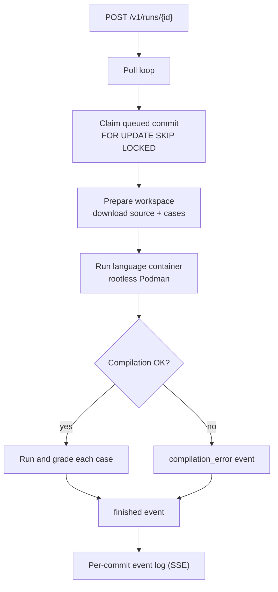
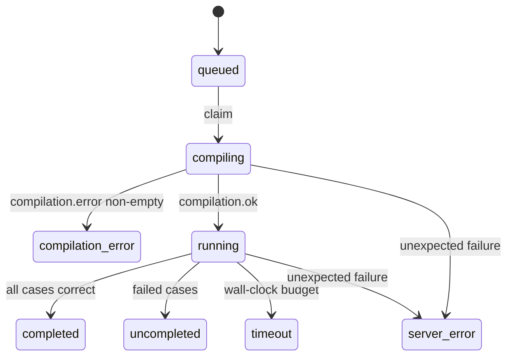

# Judge

The judge is the execution engine for submissions. It is the successor to the
legacy Python `compiler-engine` and runs the language images from `runners/`
with **rootless Podman** instead of Docker.

It is **compute-only**: it claims queued commits from PostgreSQL, reads its
inputs from SeaweedFS, runs the matching language container, grades the output,
and streams events to the backend over SSE. It never writes results or uploads
artifacts; the backend owns all persistence.

## How a submission flows

1. The backend registers a `queued` commit, uploads the source and test-case
   files to SeaweedFS, and calls `POST /v1/runs/{id}` to wake the judge.
2. A worker claims the commit from PostgreSQL with
   `SELECT ... FOR UPDATE SKIP LOCKED`, writing only the claim
   (`status = compiling`, `compilation_started = now()`). At most
   `JUDGE_CONCURRENCY` containers run at once, and no submission is lost.
3. The worker prepares a per-commit workspace, mounts it into the language
   image at `/root`, and drives the image's script through the
   `compilation.start/done` and `run.start/done` milestones.
4. Every status change, per-case verdict and the terminal `finished` event is
   published to a replayable, per-commit event log. The backend consumes it with
   `GET /v1/runs/{id}/events`.



## The queue

PostgreSQL is the durable queue. The claim is:

```sql
UPDATE commits SET status = 'compiling', compilation_started = now()
WHERE id = (
  SELECT id FROM commits WHERE status = 'queued'
  ORDER BY created_at
  FOR UPDATE SKIP LOCKED
  LIMIT 1
)
RETURNING id;
```

The judge only ever writes this claim. Postgres keeps the row safe across judge
crashes and allows multiple judge instances to claim different commits without
coordination.

The poll loop wakes on `POST /v1/runs/{id}` (idempotent) and otherwise polls
every `JUDGE_POLL_INTERVAL` (default 1s). The wake endpoint is an optimization;
the durable queue does the real work.

## State machine



`case_result.status` maps to the database enum `correct`,
`bad_formatted_output`, or `killed_with_signal`. `finished.status` maps to
`completed`, `uncompleted`, `compilation_error`, `server_error`, or `timeout`.
The score is a percentage in `[0, 100]`.

## Endpoints

| Method | Path | Description |
| --- | --- | --- |
| GET | `/healthz` | liveness |
| GET | `/readyz` | PostgreSQL + Podman reachable (backend pre-check) |
| POST | `/v1/runs/{id}` | wake the poll loop for a commit |
| GET | `/v1/runs/{id}/events` | replayable SSE stream (`?from=<seq>`) |
| GET | `/v1/runs/{id}/output` | generated output archive |
| HEAD | `/v1/runs/{id}/output` | whether the output archive exists |

`/v1` requires `Authorization: Bearer $JUDGE_AUTH_TOKEN` (or
`RUNCODES_JUDGE_TOKEN`). While no token is configured, every `/v1` request is
refused with `503` instead of being served to anyone who can reach the port,
because the API exposes other people's submissions and outputs. A local-only
instance can opt out with `JUDGE_ALLOW_INSECURE=true`; the judge logs a warning.

The full event schema is in [Judge API](../api/judge.md).

## Container contract

The workspace is bind-mounted at `/root`. The image's `CMD /usr/bin/runcodes`
sources `container.config` from there. The judge writes:

```ini
monitor_max_fs=5242880        # only when JUDGE_MONITOR_MAX_FILE_SIZE is set
monitor_max_ms=268435456      # only when JUDGE_MONITOR_MAX_MEM_SIZE is set
compilation_timeout=10        # only when JUDGE_DEFAULT_COMPILATION_TIMEOUT is set
run_nonce='7f3c…'
src_file='submission.c'       # or the selected entry point inside a zip
t_<case_id>=5                 # wall-clock seconds for the case
ms_<case_id>=67108864         # address space, only when the exercise sets one
fs_<case_id>=1048576          # file size, only when the exercise sets one
stack_<case_id>=1048576       # stack, only when the exercise sets one
```

The harness expects the milestones `compilation.start`, `compilation.done`,
`run.start` and `run.done`, each printed as `<name> <run_nonce>`. Languages that
do not compile skip the compilation milestones.

Text test-case inputs and expected outputs are materialised from the database
columns; file-based cases use their S3 objects. This keeps legacy text cases,
which never had separate objects, gradeable.

These globals override the image's own defaults. The language script is appended
to the base script and assigns `monitor_max_fs`, `monitor_max_ms` and
`compilation_timeout` itself (for example Python asks for 1 GiB). The harness
snapshots the values it read before running the language script and prefers
them, which is why the judge writes those three keys **only when the deployment
sets them**: the per-language default belongs to the image, the per-case limit
belongs to the exercise, and the deployment-wide value is an operator override.

### Why the nonce

Milestones travel on the container's log stream, which also carries the
submission's own output. A program could print `run.done` itself and send the
judge off to grade whatever happens to be on disk. The harness therefore reads
`run_nonce` from `container.config`, **deletes the file**, and appends the nonce
to every milestone. The judge only accepts an exact `<name> <nonce>` line.
Deleting the file before compilation matters because a Makefile submission can
execute arbitrary code while "compiling". A milestone without the nonce is
logged as a warning and ignored; the usual cause is an image built from an older
`runners/` release.

## Limits

Graded code is untrusted, so limits are applied twice: from outside the
container by cgroups, and from inside by the monitor. The judge never relies on
the inner limits alone, because the submission shares privileges with the
monitor and can defeat it.

### Judge-side cgroup caps

| Variable | Default | Purpose |
| --- | --- | --- |
| `JUDGE_CONTAINER_MEMORY_BYTES` | 1536 MiB | memory and swap cap per concurrent run |
| `JUDGE_CONTAINER_PIDS_LIMIT` | 256 | process/thread cap (fork bombs) |
| `JUDGE_CONTAINER_CPU_QUOTA` | 100000 | CPU per 100 ms period (one full core) |
| `JUDGE_CONTAINER_TMPFS_BYTES` | 256 MiB | writable `/tmp` cap; `/run` is fixed at 16 MiB |

The memory cap is deliberately above the largest default a language image sets
(1 GiB): a run that reaches the image's own limit is reported as exceeding it,
while one that reaches the cgroup cap is seen only as a process killed by a
signal. The cap applies per concurrent run, so `JUDGE_CONCURRENCY` multiplies it.

### Image-side limits

The monitor inside the container enforces the per-case CPU, memory, stack and
file-size limits. The judge passes the exercise limits as `t_`, `ms_`, `fs_`,
and `stack_` keys. `JUDGE_MONITOR_MAX_FILE_SIZE` and
`JUDGE_MONITOR_MAX_MEM_SIZE` (both default 0) are deployment-wide overrides;
0 sends nothing and leaves each language image's own default in place.

### Timeouts and read bounds

| Variable | Default | Meaning |
| --- | --- | --- |
| `JUDGE_COMPILATION_WAIT` | 2m | the judge's patience for compilation milestones |
| `JUDGE_DEFAULT_COMPILATION_TIMEOUT` | 0 (image default) | container compilation timeout; 10s for most, 60s for Go/C#/Julia, 20s for Zig |
| `JUDGE_DEFAULT_EXEC_TIMEOUT` | 5s | default execution timeout |
| `JUDGE_DEFAULT_CASE_TIMEOUT` | 3s | default per-case timeout |
| `JUDGE_MAX_RUN_DURATION` | 30m | end-to-end budget for one claimed commit |
| `JUDGE_MAX_COMPARE_FILE_BYTES` | 16 MiB | max size of the two files a case is graded from |
| `JUDGE_MAX_ARTIFACT_BYTES` | 64 MiB | max output archive size |
| `JUDGE_ARTIFACT_TTL` | 168h | how long a published output archive is kept; 0 keeps it forever |
| `JUDGE_MAX_EXTRACT_FILE_BYTES` | 64 MiB | max single entry when unpacking a zip |
| `JUDGE_MAX_EXTRACT_BYTES` | 256 MiB | max total expanded zip size |
| `JUDGE_MAX_EXTRACT_ENTRIES` | 1000 | max entries in a zip submission |
| `JUDGE_MAX_WORKSPACE_BYTES` | 1 GiB | aggregate workspace size; sampled every 250 ms while the run is alive |
| `JUDGE_MAX_WORKSPACE_ENTRIES` | 50000 | aggregate workspace entries/inodes; sampled every 250 ms while the run is alive |
| `JUDGE_MAX_OUTPUT_FILE_SIZE` | 1 MiB | max size of one output file collected |

Exceeding either workspace cap kills the container and finishes the run as
`server_error`; the caps are sampled safety valves, not kernel-enforced
filesystem quotas. Unlinked open files and writers fast enough to outrun the
250 ms sample can still exceed them, so size the execution volume as well.

`JUDGE_COMPILATION_WAIT` must outlast the image's compilation timeout plus
container startup. When both are configured, the judge validates the pairing at
startup: equal or shorter values race and report a milestone timeout instead of
the compiler's error.

`JUDGE_MAX_RUN_DURATION` bounds image pulls, container creation and S3 reads too,
so a stuck run cannot pin a worker slot forever. Keep it above the longest
legitimate run and aligned with the backend's
`RUNCODES_JUDGE_STALE_TIMEOUT`.

## Isolation

The container spec is built by `internal/podman` and asserted by
`spec_test.go`. Beyond the resource limits:

- its own **PID, UTS and IPC namespaces**;
- **no network namespace**, so submitted code cannot reach the internet, the
  compose network, the backend or SeaweedFS;
- **`no-new-privileges`**, so a setuid binary or a file capability in a language
  image cannot give the submission rights the monitor does not hold;
- **`cap_drop=ALL`**, so the runtime's default capability set is not inherited;
- **core dumps disabled** (`RLIMIT_CORE=0`), so a crash cannot fill the workspace;
- a **read-only image filesystem**, with size-capped tmpfs at `/tmp` and `/run`
  for compiler/runtime scratch space;
- exactly one persistent mount: the run's workspace at `/root`;
- a **zero umask**, because the container's uid is not the judge's. With the
  default umask, build trees would be owned by a subuid the judge cannot remove,
  and the shared exec directory would grow without bound.

Every language image runs as an unprivileged `runcodes` user, never root. The
harness inherits that identity, so compilation and execution have exactly the
permissions the harness has. The judge does not depend on the numeric uid, only
on the shape: non-root and `$HOME=/root`, where the workspace is mounted.

## Outputs and trust

The judge reads `compilation.out`/`.err` and, per case, `<id>.output`,
`<id>.error` and `<id>.monitor_out` from the shared workspace. Everything except
the monitor report is the submission's own product, so the judge:

- downloads expected answers into a **private directory beside** the workspace,
  never into the mount;
- refuses to read anything from the workspace that is not a regular file (no
  symlinks);
- only trusts the monitor report, which the monitor writes after killing the
  command's process group and renames into place, so it cannot be pre-created or
  written through;
- kills the container's remaining processes after each case and after
  compilation, so a daemonized program cannot rewrite results;
- stops the container **before** grading;
- reports a harness that exits non-zero after `run.done` as `server_error`
  instead of grading half-collected outputs.

The monitor report carries `exit_status`, `signal` and `time`. It does **not**
carry memory usage, because the monitor is not the program's parent (the harness
runs it through `timeout`). `mem_usage` is therefore recorded as `-1` (unknown)
rather than as a number the judge cannot stand behind.

## Failure handling

| Failure | Result |
| --- | --- |
| Compiler error | `compilation_error` with the compiler's message |
| Milestone timeout | `server_error` (the judge gave up waiting) |
| Wall-clock budget exceeded | `timeout` |
| Harness exits non-zero after `run.done` | `server_error` |
| Podman unavailable | `/readyz` fails; the backend refuses new submissions |
| Judge crashes mid-run | row stays claimed; the backend's sweeper marks it `server_error` |
| Finished run older than `JUDGE_EVENT_RETENTION` | events evicted; backend serves persisted state |

Finished runs remain replayable in memory for `JUDGE_EVENT_RETENTION` (default
10 minutes) after they finish. After that, clients must read the terminal state
from the backend's database.

## Running the judge

```bash
cd judge
make build          # produces bin/judge
make test
make run
```

The build **requires** the Podman remote/storage opt-out tags (see the
`Makefile`); without them the Podman bindings need `gpgme`/`btrfs` development
headers that a judge host does not have.

The judge needs a rootless Podman API socket:

```bash
systemctl --user start podman.socket   # unix:///run/user/$UID/podman/podman.sock
```

And a writable shared execution directory:

```bash
mkdir -p ./exec && chmod 0777 ./exec
```

The directory is tracked in the repository (`exec/.gitkeep`) because Podman,
unlike Docker, refuses to create a missing bind-mount source. The one-shot
`judge-exec-init` Compose service prepares it automatically.

### Shared directory in Compose

The judge creates one workspace per commit under `JUDGE_EXEC_DIR` (mounted at
`/exec`) and shares it with the Podman service through `JUDGE_EXEC_DIR_REMOTE`,
so language containers can bind-mount it. In Compose:

- `JUDGE_EXEC_DIR=/exec` inside the judge container;
- `JUDGE_EXEC_DIR_REMOTE` is the host's absolute path to `./exec`;
- the judge runs as root inside its namespace and uses `userns_mode: keep-id`
  in the Ansible deployment, so the host user owns the workspace.

The judge sweeps this directory at startup and hourly: `commit_*`/`expected_*`
workspaces older than `JUDGE_MAX_RUN_DURATION` plus a five-minute grace period are
removed, and `outputs/*.zip` older than `JUDGE_ARTIFACT_TTL` (default 168h, 0
keeps them) are deleted. It also removes containers labeled
`io.runcodes.commit` left by a previous process before starting workers.

## Integration test

`make integration` starts ephemeral PostgreSQL and SeaweedFS containers, loads
the schema, seeds a commit and a test case, uploads source and test I/O, and runs
the real engine against a real language image through rootless Podman. The Go
test is skipped unless `JUDGE_TEST_DB_DSN` is set; the harness sets it.

Requirements: Docker (for the two dependencies), `curl`, a rootless Podman
socket, and the C runner image (pulled on demand).

```bash
cd judge
make integration              # starts containers, runs the test, tears down
./integration/run.sh --keep   # keep the containers for inspection
```

The harness creates, migrates and drops its own scratch database, so it connects
as the owner (`runcodes`); a deployment points the judge at `runcodes_judge`
instead. Useful overrides:

| Variable | Default | Purpose |
| --- | --- | --- |
| `JUDGE_TEST_DB_DSN` | set by the harness | PostgreSQL DSN (the test skips if unset) |
| `RUNCODES_S3_ENDPOINT` | `http://127.0.0.1:8333` | S3 endpoint |
| `RUNCODES_S3_BUCKET_PREFIX` | `runcodes-itest` | bucket prefix |
| `JUDGE_PODMAN_URI` | `unix:///run/user/$UID/podman/podman.sock` | Podman socket |
| `JUDGE_TEST_IMAGE_FORMAT` | `ghcr.io/runcodes-icmc/runcodes-runner-%s:latest` | image format |
| `JUDGE_TEST_KEEP` | `false` | keep per-commit workspaces |
| `ITEST_DB_PORT` / `ITEST_S3_PORT` | `55432` / `18333` | host ports |

## Observability

The judge emits traces, metrics and logs when
`OTEL_EXPORTER_OTLP_ENDPOINT` is set:

- `judge.process_commit` root span per claim, with `runcodes.commit.id`;
- `judge.prepare_workspace`, `judge.run_container`, and one
  `judge.grade_test_case` span per test case (case id, verdict, CPU time, memory);
- async gauges `runcodes.judge.queue.depth` and
  `runcodes.judge.queue.oldest_age`;
- `PPROF_ADDR` for Alloy/Pyroscope, with `otel-profiling-go` linking spans to
  flame graphs;
- logs with `trace_id`/`span_id`, forwarded over OTLP.

## Related pages

- [Judge API](../api/judge.md) — exact event schemas and endpoints.
- [Runner images & monitor](./runners-and-monitor.md) — the other half of the
  contract.
- [Judge configuration](../reference/configuration.md#judge) — every variable.
- [Observability](../observability/index.md) — dashboards and queue alerts.
