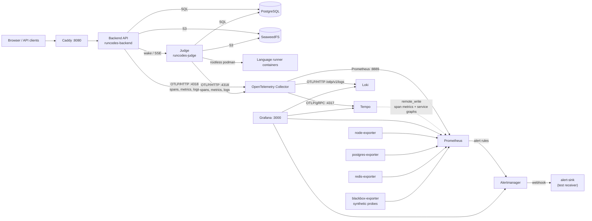

# RunCodes observability stack

This directory (and `observability/`) adds a complete, open-source
metrics/logs/traces stack to the RunCodes platform:

| Pillar          | Component                          | Role in this stack                                      |
| --------------- | ---------------------------------- | ------------------------------------------------------- |
| Collection      | OpenTelemetry Collector (contrib)  | OTLP gateway for traces, metrics and logs               |
| Metrics         | Prometheus                         | Application, trace-derived and infrastructure metrics   |
| Logs            | Loki                               | OTel application logs, queryable by service and trace    |
| Traces          | Grafana Tempo                      | Distributed traces + span metrics / service graph       |
| Visualisation   | Grafana                            | Dashboards, Explore, cross-signal correlation           |
| Alerting        | Alertmanager + Prometheus rules    | Alert routing, grouping, inhibition, webhook delivery   |
| Instrumentation | OpenTelemetry Go SDK               | Backend + judge traces, metrics, structured logs        |
| Optional        | Grafana Pyroscope                  | Not deployed; see [Known limitations](#known-limitations) |

The stack is **opt-in** and runs as a Docker Compose overlay on top of the
existing application stack. `docker compose up` keeps its current behaviour; use
`make observability-up` (or the explicit `-f` command below) to include it.

- [Architecture](#architecture)
- [Data flow](#data-flow)
- [Ports and endpoints](#ports-and-endpoints)
- [Configuration](#configuration)
- [Local development](#local-development)
- [Production guidance](#production-guidance)
- [Retention, resources and scaling](#retention-resources-and-scaling)
- [Security notes](#security-notes)
- [Known limitations](#known-limitations)
- [Validation](#validation)

## Architecture



### Component responsibilities

| Component | Image (pinned) | Responsibility | Persistence |
| --- | --- | --- | --- |
| `otel-collector` | `otel/opentelemetry-collector-contrib:0.163.2` | Receives OTLP, applies memory limiting/batching/resource attributes, exports traces to Tempo, logs to Loki, metrics to a Prometheus endpoint | none |
| `prometheus` | `prom/prometheus:v3.15.1` | Scrapes the collector, infrastructure exporters and blackbox probes; evaluates recording/alert rules; accepts Tempo remote writes | `prometheus-data` (15d / 8GB retention) |
| `alertmanager` | `prom/alertmanager:v0.34.1` | Groups, inhibits and delivers alerts; webhook receiver points at `alert-sink` | `alertmanager-data` |
| `loki` | `grafana/loki:3.7.9` | Stores OTel logs with structured metadata (`trace_id`, severity); labels `service_name`, `service_namespace`, `deployment_environment_name` | `loki-data` (7d compactor retention) |
| `tempo` | `grafana/tempo:3.1.1` | Stores traces locally; metrics-generator derives span metrics and service graphs and remote-writes them to Prometheus | `tempo-data` (7d block retention) |
| `grafana` | `grafana/grafana:12.4.13` | Datasources, dashboard, Explore and Alerting UI | `grafana-data` |
| `node-exporter` | `prom/node-exporter:v1.12.1` | Host CPU/memory/filesystem/network metrics | none |
| `postgres-exporter` | `prometheuscommunity/postgres-exporter:v0.20.1` | PostgreSQL metrics using the `runcodes_app` role | none |
| `redis-exporter` | `oliver006/redis_exporter:v1.95.0` | Redis cache metrics | none |
| `blackbox-exporter` | `prom/blackbox-exporter:v0.29.1` | HTTP probes of backend/judge/frontend/Grafana/Loki/Tempo/Alertmanager | none |
| `alert-sink` | `python:3.14-slim-trixie` | Local webhook receiver used by the smoke test to prove alert delivery | in-memory, last 100 payloads |

Versions live in [`docker-compose.observability.yml`](../docker-compose.observability.yml).
Pin new versions there and in `scripts/observability/validate.sh` together.

## Data flow

### Application -> collector

The backend and judge use the OpenTelemetry Go SDK. Instrumentation is **off by
default** and switches on when `OTEL_EXPORTER_OTLP_ENDPOINT` is set; the
Compose overlay sets it to `http://otel-collector:4318`.

- **Traces**: inbound HTTP spans from chi (`otelchi`), outbound HTTP spans
  (`otelhttp`) for judge and S3 calls, and database spans from `otelsql`.
  W3C `traceparent`/`tracestate` are propagated. A request from the backend to
  the judge shares one trace; the background worker starts a new root trace per
  claimed commit with `runcodes.commit.id` attributes.
- **Metrics**: `http.server.request.duration` and `http.server.active_requests`
  are recorded by the backend/judge HTTP middleware, with the chi route pattern
  as `http.route` (not the raw path, so a path id does not explode cardinality).
  Go runtime metrics and database pool metrics are added by the OTel runtime
  and `otelsql` instrumentation.
- **Logs**: every `slog` record is written to stdout (trace ids included) and
  forwarded as an OTLP log record. OTel's log SDK attaches the active
  `trace_id`/`span_id` to the record; Loki stores them as structured metadata,
  which is what the Grafana derived field and Tempo's trace-to-logs query use.
- **Resource attributes**: `service.name` (`runcodes-backend` / `runcodes-judge`),
  `service.namespace=runcodes`, `service.version`, `service.instance.id` and
  `deployment.environment.name` (from `DEPLOYMENT_ENVIRONMENT`). Standard
  `OTEL_RESOURCE_ATTRIBUTES` and `OTEL_SERVICE_NAME` override the defaults.

### Collector -> backends

- Traces: `otlp/tempo` (gRPC) -> Tempo `:4317`.
- Logs: `otlphttp/loki` -> `http://loki:3100/otlp/v1/logs`.
- Metrics: the collector's `prometheus` exporter on `:8889`; Prometheus scrapes
  it every 10s. `resource_constant_labels` promotes `service.name`,
  `service.namespace`, `service.version` and `deployment.environment.name` to
  labels, so `service_name` is present on every application metric. The full
  resource is available on `target_info`; high-cardinality attributes are not
  copied to every series.
- Batching (5s), retries (exponential, 300s max), sending queues and a memory
  limiter are configured in
  [`observability/otel-collector/config.yaml`](../observability/otel-collector/config.yaml).

### Correlation paths

| From | To | How |
| --- | --- | --- |
| Metrics | Traces | Prometheus datasource exemplar mapping (`trace_id` -> Tempo). Tempo span metrics create exemplars. |
| Traces | Logs | Tempo datasource `tracesToLogsV2`: selects Loki `{service_name="..."} | trace_id="..."`. |
| Logs | Traces | Loki derived field `TraceID` with `matcherType: label` (structured metadata) -> Tempo. |
| Traces | Metrics | Tempo `tracesToMetrics`: maps `service.name` to the Prometheus `service_name` label. Tempo's span metrics use the short `service` label; dashboards and the trace-error alert use it. |
| Dashboard | All | The `service` template variable filters panels by OTel `service.name`. |

The backend also returns a `TraceId` response header (32 hex chars) and
`X-Trace-Sampled`, so an API user can report a trace id and an operator can open
it directly in Tempo. The smoke test uses this header end to end.

## Ports and endpoints

All published ports bind to **127.0.0.1** by default (`OBSERVABILITY_BIND_ADDRESS`).
Nothing in this overlay should be exposed publicly without an authenticating
reverse proxy.

| Service | Host URL | Container endpoint | Notes |
| --- | --- | --- | --- |
| Grafana | http://localhost:3000 | `grafana:3000` | login required, generated admin password |
| Prometheus | http://localhost:9090 | `prometheus:9090` | UI/API/remote-write receiver |
| Alertmanager | http://localhost:9093 | `alertmanager:9093` | UI/API |
| Loki | http://localhost:3100 | `loki:3100` | API; readiness `/ready`; no UI |
| Tempo | http://localhost:3200 | `tempo:3200` | API; readiness `/ready`; no UI |
| OTLP gRPC | `localhost:4317` | `otel-collector:4317` | for local apps; internal apps use the compose network |
| OTLP HTTP | `localhost:4318` | `otel-collector:4318` | same |
| Collector health | http://localhost:13133/health/status | `otel-collector:13133` | health_check extension |
| Collector self-metrics | http://localhost:8888/metrics | `otel-collector:8888` | Prometheus scrape target |
| Collector OTLP metrics | http://localhost:8889/metrics | `otel-collector:8889` | application metrics, scraped by Prometheus |
| Node exporter | http://localhost:9100/metrics | `node-exporter:9100` | host metrics |
| Postgres exporter | http://localhost:9187/metrics | `postgres-exporter:9187` | DB metrics |
| Redis exporter | http://localhost:9121/metrics | `redis-exporter:9121` | cache metrics |
| Blackbox exporter | http://localhost:9115 | `blackbox-exporter:9115` | `/probe?target=...` |
| Alert sink | http://localhost:8085 | `alert-sink:8080` | test receiver, no auth |
| Frontend | http://localhost:8080 | `frontend:80` | existing app |
| Backend | http://localhost:8443/healthz | `backend:8443` | existing app, loopback only |
| Judge | http://localhost:9000/healthz | `judge:9000` | existing app, loopback only |

The application's own readiness endpoint is `GET /readyz`: the database is
required (503 when it is unreachable) and the judge is reported as `ok` or
`unavailable` without failing readiness. Liveness remains `GET /healthz` and is
what the Docker `HEALTHCHECK` uses.

## Configuration

### Application (standard OpenTelemetry variables)

| Variable | Default in this stack | Meaning |
| --- | --- | --- |
| `OTEL_EXPORTER_OTLP_ENDPOINT` | `http://otel-collector:4318` (Compose) | Enables export. Unset = instrumentation is a no-op. |
| `OTEL_EXPORTER_OTLP_PROTOCOL` | `http/protobuf` | OTLP/HTTP protobuf |
| `OTEL_SERVICE_NAME` | `runcodes-backend` / `runcodes-judge` | `service.name` |
| `DEPLOYMENT_ENVIRONMENT` | `development` | `deployment.environment.name` |
| `OTEL_SERVICE_VERSION` | `dev` | `service.version` |
| `OTEL_TRACES_SAMPLER` | `parentbased_always_on` | `always_on`, `always_off`, `traceidratio`, `parentbased_traceidratio`, ... |
| `OTEL_TRACES_SAMPLER_ARG` | `1.0` | ratio for the ratio samplers; set e.g. `0.1` in production |
| `OTEL_SDK_DISABLED` | `false` | standard kill switch |
| `OTEL_METRIC_EXPORT_INTERVAL` | `10000` ms | OTLP metric export interval |
| `OTEL_BSP_SCHEDULE_DELAY` | `2000` ms | span batch delay |
| `OTEL_BLRP_SCHEDULE_DELAY` | `2000` ms | log batch delay |
| `OTEL_RESOURCE_ATTRIBUTES` | unset | extra resource attributes, e.g. `service.team=platform` |

All are set on both `backend` and `judge` by the overlay. The standard
`OTEL_EXPORTER_OTLP_HEADERS`, `OTEL_EXPORTER_OTLP_TIMEOUT` and signal-specific
endpoints are honoured by the OTel Go exporters, which makes it possible to point
a deployment at a managed collector over HTTPS without code changes.

### Stack-wide

| Variable | Default | Meaning |
| --- | --- | --- |
| `OBSERVABILITY_BIND_ADDRESS` | `127.0.0.1` | host interface for all published observability ports |
| `GRAFANA_ADMIN_USER` | `admin` | Grafana admin login |
| `GRAFANA_ADMIN_PASSWORD` | generated file | read from `.observability/grafana_admin_password`; not passed in the environment |
| `GRAFANA_ROOT_URL` | `http://localhost:3000` | links generated by Grafana |
| `GRAFANA_PORT`, `PROMETHEUS_PORT`, `ALERTMANAGER_PORT`, `LOKI_PORT`, `TEMPO_PORT` | `3000`, `9090`, `9093`, `3100`, `3200` | port overrides |
| `OTEL_GRPC_PORT`, `OTEL_HTTP_PORT`, `OTEL_HEALTH_PORT`, `OTEL_METRICS_PORT`, `OTEL_PROM_PORT` | `4317`, `4318`, `13133`, `8888`, `8889` | collector port overrides |
| `NODE_EXPORTER_PORT`, `POSTGRES_EXPORTER_PORT`, `REDIS_EXPORTER_PORT`, `BLACKBOX_EXPORTER_PORT`, `ALERT_SINK_PORT` | `9100`, `9187`, `9121`, `9115`, `8085` | exporter port overrides |

The Grafana password is generated by `scripts/observability/init-secrets.sh`
into `.observability/` (gitignored) and mounted as a read-only file. It is not
stored in `.env`, Compose or any image layer. If you override
`GRAFANA_ADMIN_PASSWORD` in the shell, the smoke test uses it; the Compose
service still reads the file, so keep them in sync or regenerate the file.

## Local development

### Prerequisites

- Docker Compose v2 (or a Docker-compatible API; Podman's socket works with
  `DOCKER_HOST=unix://$XDG_RUNTIME_DIR/podman/podman.sock`).
- `make`, `curl`, `jq`.
- The existing application secrets in `.env` (see the root `.env.example`) and
  the judge's rootless podman socket if you want submissions to run.

### Start, validate, stop

```bash
# Generate the local Grafana password once (idempotent)
make observability-init

# Build the app images with instrumentation and start every service
make observability-up

# Generate traffic and check Prometheus, Loki, Tempo, Grafana and Alertmanager
make observability-smoke-test

# Status / logs
make observability-status
make observability-logs

# Stop containers, keep telemetry volumes
make observability-down

# DESTRUCTIVE: remove only the observability volumes (Prometheus/Loki/Tempo/
# Grafana/Alertmanager); application volumes are kept. Prompts; FORCE=1 skips.
make observability-destroy
```

The equivalent explicit command is (run `make observability-init` or
`./scripts/observability/init-secrets.sh` first so the Grafana password file
exists):

```bash
docker compose -f docker-compose.yml -f docker-compose.observability.yml up -d --build
```

Then open <http://localhost:3000/d/runcodes-overview>. The dashboard includes
service request rate, error rate, latency, logs, trace span metrics, host and
database resources, and links to Explore.

### Running a service outside Compose

The backend and judge are no-op unless an endpoint is set. To run one locally
against the collector:

```bash
export OTEL_EXPORTER_OTLP_ENDPOINT=http://127.0.0.1:4318
export OTEL_EXPORTER_OTLP_PROTOCOL=http/protobuf
export OTEL_SERVICE_NAME=runcodes-backend
export DEPLOYMENT_ENVIRONMENT=development

cd backend && go run . -debug
```

The collector publishes 4317/4318 on loopback, so a process on the host can send
telemetry without joining the Compose network. Use `OTEL_SDK_DISABLED=true` to
turn instrumentation off again.

### Configuration as code

| Path | Purpose |
| --- | --- |
| `docker-compose.observability.yml` | services, images, ports, volumes, limits |
| `observability/otel-collector/config.yaml` | OTLP pipelines and processors |
| `observability/prometheus/prometheus.yml` | scrape jobs and Alertmanager target |
| `observability/prometheus/rules/runcodes-alerts.yml` | recording rules and alerts |
| `observability/loki/loki.yaml` | single-binary Loki, retention, OTLP label mapping |
| `observability/tempo/tempo.yaml` | single-binary Tempo, retention, metrics-generator |
| `observability/alertmanager/alertmanager.yml` | routes, receivers, inhibition |
| `observability/grafana/provisioning/` | datasources, dashboard provider, alerting |
| `observability/grafana/dashboards/runcodes-overview.json` | the dashboard |
| `scripts/observability/validate.sh` | static validation |
| `scripts/observability/smoke-test.sh` | end-to-end validation |

Do not create resources only in the Grafana UI: provisioned resources are
read-only in the UI and are the source of truth.

## Production guidance

This overlay is a development/single-host stack. It is deliberately simple
(local filesystem, one replica, no TLS) and should not be copied to production
unchanged. The following adapts the same architecture to a real environment.

### Deployment model

- **Kubernetes**: deploy Prometheus, Alertmanager, Loki, Tempo and Grafana with
  their community Helm charts (or the Grafana LGTM distributed charts). Run the
  collector as a **DaemonSet** (or a gateway Deployment behind a Service), not
  as a single container. Add ServiceMonitors/PodMonitors or `prometheus.yml`
  scrape configs for the exporters. Use PodDisruptionBudgets, anti-affinity and
  resource requests/limits.
- **VMs/bare metal**: keep the collector as a gateway (or one per node), use
  systemd units, and run Prometheus in agent/remote-write mode if the metrics
  volume outgrows one instance.
- **Compose on one host**: use this overlay only for development, demos or a
  small single-node installation with an authenticating reverse proxy.

### Storage and retention

| Signal | Dev default here | Production recommendation |
| --- | --- | --- |
| Metrics | Prometheus local TSDB, 15d / 8GB | Managed Prometheus/Mimir or Thanos; remote write; 15–90d retention; downsampling for long-term |
| Logs | Loki filesystem, 7d | Loki with S3/GCS/Azure object storage, 30–90d (longer for audit); configure `limits_config` ingestion limits and per-tenant retention |
| Traces | Tempo local blocks, 7d | Tempo with S3/GCS/Azure object storage, 7–30d; tail sampling or 10% head sampling |
| Profiles | not deployed | Pyroscope with object storage; add `pyroscope.scrape` in Alloy or `pyroscope-go` push in the services |

Always set retention **and** a storage quota. A single misbehaving service can
otherwise fill the disk; the `RunCodesHostDiskSpaceLow` alert is a last resort,
not the plan.

### Scaling notes

- **Collector**: stateless; scale horizontally. Use a memory limiter sized to
  the container, a persistent sending queue if you cannot tolerate collector
  restarts, and a load balancer in front of multiple replicas. For very high
  trace volume, add tail sampling here.
- **Prometheus**: a single instance is a development choice. For production use
  remote write to Mimir/Thanos or shard by tenant. Tempo span metrics add
  cardinality (`service_name`, `span_name`, `status_code`); cap or drop labels
  you do not query.
- **Loki**: use the distributed chart with object storage and a shared ring.
  The OTLP label mapping in this repo keeps only three index labels to limit
  stream cardinality; keep `service.instance.id` out of index labels.
- **Tempo**: use object storage and a compactor (or the distributed chart). The
  metrics-generator can be scaled separately; it is CPU- and memory-intensive.
- **Grafana**: external database (PostgreSQL/MySQL), SSO/OAuth, HA replicas and
  a load balancer. Do not use the SQLite default for a team deployment.

### Sampling and volume

The default sampler is `parentbased_always_on` for easy debugging. Production
should set `OTEL_TRACES_SAMPLER=parentbased_traceidratio` and
`OTEL_TRACES_SAMPLER_ARG=0.1` (or tail sampling in the collector) and keep error
traces. Metrics are cheap by comparison; logs are the biggest cost, so set Loki
ingestion limits and avoid logging request bodies outside debug mode.

### TLS, auth and secrets

- Terminate TLS at an ingress/reverse proxy (or use the charts' TLS support).
  The overlay speaks plaintext inside the Compose network.
- Protect Grafana with SSO and a strong generated password. The local
  `.observability/grafana_admin_password` file is for development only; use a
  secret manager or `GF_SECURITY_ADMIN_PASSWORD__FILE` from a mounted Kubernetes
  secret in production.
- OTLP has no authentication in this stack. Either keep the collector on a
  private network or enable mTLS/bearer auth (`basicauth`/`oauth2client`
  extensions) and TLS on the receivers. The same applies to Tempo, Loki and
  Prometheus: they are unauthenticated by default.
- Never commit credentials. Alertmanager receivers should read credentials from
  mounted secret files (`*_file` settings), not from YAML.
- Give the collector the minimum filesystem/network permissions it needs. Do not
  mount the container runtime socket into it.

## Retention, resources and scaling

The Compose overlay applies these dev guardrails:

| Service | Memory limit | CPU limit | Retention / storage |
| --- | --- | --- | --- |
| Prometheus | 1 GiB | 1.0 | 15 days / 8 GiB |
| Loki | 512 MiB | 1.0 | 7 days (compactor) |
| Tempo | 512 MiB | 1.0 | 7 days (compactor) |
| Grafana | 512 MiB | 0.5 | SQLite volume |
| Collector | 512 MiB | 1.0 | in-memory queues |
| Alertmanager | 128 MiB | 0.25 | notification state volume |
| Exporters / sink | 64–128 MiB | 0.1–0.25 | none / in-memory |

These are starting points for a developer laptop, not capacity planning. Size a
production deployment from measured ingestion (samples/s, log bytes/s, spans/s)
and leave headroom for compactions and query spikes. Prometheus, Loki and Tempo
all need local disk for WAL/compaction even when the long-term store is object
storage.

## Security notes

- **Exposure**: every observability port is published on loopback. The
  application's existing network exposure is unchanged (only Caddy's 8080/8444).
  Keep it that way or put an authenticated proxy in front of Grafana.
- **Grafana**: admin password generated, sign-up disabled, anonymous access
  disabled, UI edits to provisioned resources disabled, and no plugins installed
  by default. The password file has restrictive host ownership but is readable
  by the container user (UID 472); the parent directory is the workspace. This is
  a local-development tradeoff; production must use a real secret manager.
- **Telemetry data**: logs may contain user ids, emails, request paths and
  error details. Do not enable `Debug: reveal-body-logs` in production, and
  avoid adding passwords/tokens to log attributes. Trace span attributes from
  `otelsql` include SQL statements; parameters are not exported by default.
- **Webhook sink**: `alert-sink` has no authentication and stores alerts in
  memory. It is internal-only in this stack; remove it and configure a real
  receiver for any shared environment.
- **SELinux**: the services that bind-mount repo files use `security_opt:
  label=disable` to match the existing judge/service configuration. Files must
  be world-readable (git checkout mode 0644); generated secret files in
  `.observability/` are explicitly chmod'ed by the init script.
- **Secrets**: `.env`, `.observability/` and `.cache/` are gitignored. The
  repository contains no credentials. Root `.env.example` documents only
  non-secret configuration.

## Known limitations

- **No browser/frontend instrumentation**. The SPA is not traced, so a trace
  starts at Caddy/backend. Adding `@opentelemetry/sdk-trace-web` (or Grafana
  Faro) to `frontend/` and allowing OTLP CORS in the collector is the next step.
  The backend already returns `TraceId`, and CORS allows `traceparent`.
- **Pyroscope is not deployed**. Continuous profiling is optional in the task
  and needs a profiling agent (Alloy `pyroscope.scrape` or `pyroscope-go`) plus
  pprof endpoints on the Go services. The architecture leaves room for it next
  to Tempo; see [the runbook](runbook.md#adding-pyroscope-optional).
- **Judge internals are coarse-grained**: the API, DB, S3 and per-commit worker
  spans are instrumented, but individual compilation/test-case steps are not.
- **Only application logs go to Loki**. Container logs from Postgres, Redis,
  Loki itself, etc. remain available through `docker compose logs`; adding
  Alloy's Docker log discovery (or a filelog receiver) is a future extension.
- **Single-node storage, no HA, no TLS**. The overlay is for development. The
  production section above describes the managed/distributed replacement.
- **Alerting**: the Prometheus rules are the source of truth; the Grafana-managed
  rule is an example of the unified alerting path. The local `alert-sink` only
  proves delivery; it is not Slack/PagerDuty.
- **Exemplars**: Tempo span metrics generate exemplars and the Prometheus
  datasource maps them to traces. OTel application histograms routed through the
  collector's Prometheus exporter do not currently carry exemplars.
- **Grafana's generic datasource health endpoint** returns `plugin.unavailable`
  for the external Alertmanager datasource; the smoke test checks Grafana's
  Alertmanager proxy API instead. This is a Grafana UI limitation, not a broken
  datasource.
- **Metrics names** depend on the OpenTelemetry semantic conventions in the
  SDK/collector versions above. Upgrade Prometheus rules and dashboards together
  with the collector; `make observability-validate` and the smoke test catch the
  common breakages.

## Validation

```bash
# Static: compose, promtool, amtool, collector validate, JSON/shell checks
make observability-validate

# End to end: starts/validates the stack and generates real traffic
make observability-smoke-test
```

The smoke test verifies:

1. every service is reachable (starts the stack when `SMOKE_START=1`);
2. a backend request returns a 32-hex `TraceId`;
3. Prometheus has backend and judge HTTP metrics and the collector target is up;
4. Loki returns backend logs containing the smoke id, judge logs, and the exact
   trace's log line (`trace_id` structured metadata);
5. Tempo stores the exact trace id from the response header;
6. Grafana's Prometheus/Loki/Tempo datasources are healthy, the Alertmanager
   proxy works, and the `runcodes-overview` dashboard is provisioned;
7. Alertmanager accepts an injected alert and delivers the webhook to
   `alert-sink`.

See the [runbook](runbook.md#validating-the-stack) for manual queries and
diagnostics, and [PR-SUMMARY.md](PR-SUMMARY.md) for the change set and test
results.
